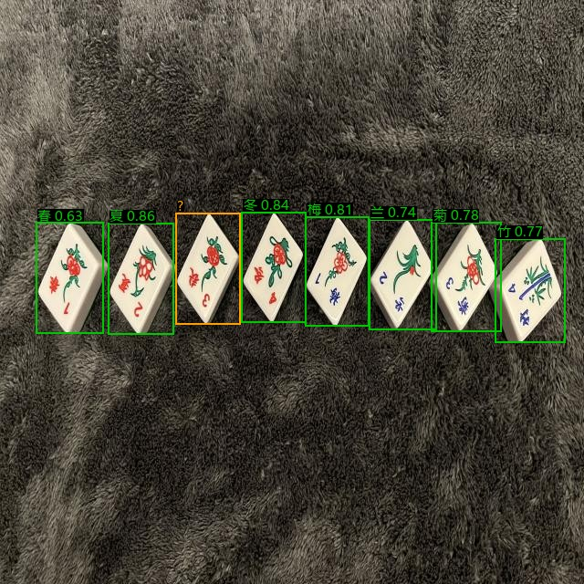
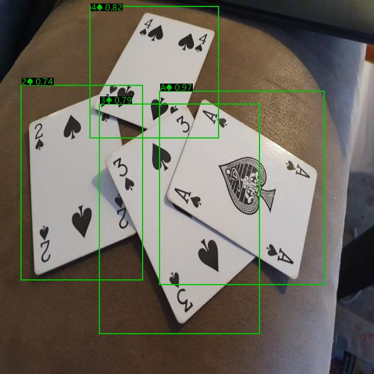

# 麻将 / 扑克牌识别模型

> M08 · bga4e
> 基于 `02_Face_recognition_project` 的 ESP-DL 推理框架，补齐「数据 → 标注修复 → 训练 → 量化/导出」整条链路。

---

## 0. 一句话总结

用公开的扑克 / 麻将检测数据集训练了一套 **两级识别流水线**：

```
摄像头图像
   │
   ├─ ① 检测器（YOLOv8n，2 类：麻将牌 / 扑克牌）→ 牌的位置
   │
   ├─ ② 按检测框裁剪 → 分类器（麻将 42 类 / 扑克 52 类）
   │
   └─ ③ 输出「3万」「A♠」等具体牌名
```

检测器与分类器均在 PC 上训练完成，可导出 ONNX / int8，并按 `02_Face_recognition_project` 中 ESP-DL 的方式迁移到 ESP32-S3。

## 0.1 直接烧录（ESP32-S3）

仓库里的 `firmware_app/` 是完整 ESP-IDF 工程，模型 int8 系数已编进 `main/model/`：

```bash
git clone https://github.com/qsyyk-z/bga4e.git
cd bga4e/firmware_app
idf.py set-target esp32s3
idf.py build
idf.py -p COMx flash monitor
```

用法：把**一张牌放在画面中央**（距离 10–20 cm），屏幕显示识别结果；**短按 BOOT** 切换麻将/扑克，**长按 BOOT** 显示/隐藏置信度。

> 数据集图像不随仓库分发，`datasets/` 只保留 `meta/`；需要复现训练时按第 3、5 节脚本从原始 `扑克/麻将` 目录重建。

---

## 1. 与 02_Face_recognition_project 的关系

`02_Face_recognition_project` 是一个 **ESP-IDF + ESP-DL 的推理工程**，本身不包含训练代码。它提供的是：

| 02 中的模块 | 本项目的用法 |
| --- | --- |
| `main/APP/esp_face_recognition.cpp`：摄像头采集任务、AI 处理任务、队列/互斥锁、按键状态机 | 端侧流水线结构完全复用：摄像头 → 检测 → 裁剪 → 分类 → LCD 绘制 |
| `components/esp-dl`：`dl_image.hpp`、`dl_layer_*`、`dl_layer_model.hpp` | 分类器的算子只使用 ESP-DL 原生支持的 Conv2D / DepthwiseConv2D / ReLU / GlobalAvgPool / FC |
| `components/esp-dl/tools/quantization_tool` + `convert_tool` | 模型量化、系数导出、`config.json` 规范直接沿用（见第 7 节） |
| `components/modules/ai/who_ai_utils.cpp`、`fb_gfx.c` | 画框、写字的显示函数可直接复用 |
| `partitions-16MiB.csv` | 模型/数据分区布局可沿用 |

> 02 的人脸流水线是「检测 → 关键点 → 对齐 → 特征 → 匹配」；本项目的牌流水线是「检测 → 裁剪 → 分类」。两者在任务调度、内存管理、显示层上结构一致，区别只在中间的模型。

---

## 2. 目录结构

```
bga4e/
├── README.md                      # 本文件
├── requirements.txt
├── datasets/
│   ├── meta/
│   │   ├── class_maps.json        # 42+52 类定义、扑克源类别重映射表
│   │   ├── annotations_clean.json# 清洗后的逐图标注（供训练/评估复用）
│   │   └── clean_report.json      # 清洗统计
│   ├── det/                       # 2 类检测数据集（YOLO 格式）
│   │   ├── images/{train,valid,test}/
│   │   ├── labels/{train,valid,test}/
│   │   └── data.yaml
│   └── cls/                       # 分类裁剪图（112×112）
│       ├── mahjong/{train,valid,test}/00..41/
│       └── poker/{train,valid,test}/00..51/
├── scripts/
│   ├── 00_check_env.py
│   ├── 01_inspect_data.py         # 原始数据体检 + 可视化
│   ├── 10_prepare_dataset.py      # 清洗、扑克重映射、生成检测/分类数据
│   ├── 12_train_detector.py       # YOLOv8n 2 类检测器
│   ├── 13_train_classifier.py     # 麻将/扑克分类器
│   ├── 14_autolabel.py            # 模型辅助补标注
│   ├── 15_eval_pipeline.py        # 检测+分类端到端评估
│   ├── 16_quantize_onnx.py        # ONNX int8 量化（PC 验证）
│   ├── 17_predict_image.py        # 单图检测+分类 demo
│   ├── 18_summary.py              # 汇总指标
│   ├── 19_eval_export.py          # 从 checkpoint 评估/导出
│   ├── 20_export_espdl_package.py # 打部署包
│   ├── 21_quantize_espdl.py       # ESP-DL 官方量化（Python 3.7）
│   ├── cardnet.py                 # 分类网络定义
│   ├── cardtools.py               # 推理/评估共用函数
│   └── run_all.ps1                # 一键流程
├── datasets/meta/                 # 类别映射、清洗标注（det/cls 图像不入库，脚本重建）
├── firmware_app/                  # 完整 ESP-IDF 工程（可直接 idf.py build/flash）
│   ├── README.md                  # 烧录/按键/标签说明
│   ├── main/APP/esp_card_recognition.cpp
│   ├── main/model/                # 两份 int8 系数 + ESP-DL C++ 模型
│   └── components/                # BSP、摄像头、LCD、ESP-DL（来自 02 工程）
├── firmware/
│   ├── README.md                  # 部署包说明
│   ├── mahjong/                   # ONNX、int8、ESP-DL 系数、C++ 模型
│   └── poker/
├── models/
│   ├── pretrained/yolov8n.pt
│   ├── detector/                  # best.pt / best_320.onnx / best_640.onnx / metrics.json
│   │   └── auto/                  # 补标微调版（对比用，未作为最终模型）
│   ├── classifier_mahjong/        # best.pt / classifier.onnx / classifier_int8.onnx / classes.json / metrics.json
│   └── classifier_poker/
├── runs/                          # 训练日志、曲线、混淆矩阵
└── report/
    ├── 训练报告.md
    ├── metrics_summary.md
    ├── audit_raw.json
    ├── autolabel.json             # 自动补标清单（825 个新框）
    ├── mahjong_class_sheets/      # 42 类人工核对图
    ├── poker_class_sheets/        # 扑克类别核对图
    ├── det/                       # 检测器曲线/混淆矩阵
    └── pipeline_metrics.json
```

---

## 3. 数据来源与标注修复（本项目的主要工作之一）

### 3.1 原始数据

| 数据集 | 位置 | 图片 | 原始框 | 类别 | 标注格式 |
| --- | --- | ---: | ---: | ---: | --- |
| 扑克（Roboflow 100） | `扑克/poker_yolo_real` | 1,285 | 5,574 | 53（含脏类 `59`） | YOLO txt |
| 麻将（真实拍摄） | `麻将/mahjong_yolo_real` | 3,713 | 53,687 | 42，**无 data.yaml** | YOLO txt |

原始数据没有「缺标签文件 / 空标签文件」；问题集中在 **类别体系** 与 **框的质量**：

### 3.2 发现的问题

1. **麻将没有类别名**：42 个类别号没有任何映射，无法训练分类器。
2. **麻将存在整排 / 多张牌粘连的大框**：4,032 个框面积超过 5%（例如一整排 14 张牌被标成 1 个框），会严重干扰检测。
3. **麻将长宽比异常框**：1,926 个框的宽高比不在 [0.22, 1.55]，多为横向长条/漏标。
4. **重复框**：37 个完全重复的框；极小框 12 个。
5. **扑克类别索引整体错位**：YOLO 导出的类别 0–18 实际是「下一张牌」，例如 `0=10♥`、`1=10♠`、`2=10♣`、`3=2♦`……，而 `20`（脏类 `59`）里放的其实是 `10♦`。直接按 `data.yaml` 训练会把牌名整体学错。
6. **扑克的 1 个噪声框**：源类别 `19` 只有 1 个框，内容是一张 J♦，属于错标。

> 这些问题不是靠「多训几个 epoch」能解决的，必须先修数据。

### 3.3 麻将类别号 → 牌名（人工逐类核对）

原始数据没有类别名。做法是：对每个类别采样 4–8 张裁剪图，拼成 contact sheet，逐类目视确认（见 `report/mahjong_class_sheets/big_*.png`、`zoom_flowers_honors.png`）。最终映射：

| 类别号 | 牌名 | 类别号 | 牌名 | 类别号 | 牌名 |
| ---: | --- | ---: | --- | ---: | --- |
| 0 | 1条 | 15 | 4条 | 30 | 8万 |
| 1 | 1万 | 16 | 4万 | 31 | 8筒 |
| 2 | 1筒 | 17 | 4筒 | 32 | 9条 |
| 3 | 梅 | 18 | 竹 | 33 | 9万 |
| 4 | 春 | 19 | 冬 | 34 | 9筒 |
| 5 | 2条 | 20 | 5条 | 35 | 东 |
| 6 | 2万 | 21 | 5万 | 36 | 发 |
| 7 | 2筒 | 22 | 5筒 | 37 | 北 |
| 8 | 兰 | 23 | 6条 | 38 | 中 |
| 9 | 夏 | 24 | 6万 | 39 | 南 |
| 10 | 3条 | 25 | 6筒 | 40 | 白 |
| 11 | 3万 | 26 | 7条 | 41 | 西 |
| 12 | 3筒 | 27 | 7万 | | |
| 13 | 菊 | 28 | 7筒 | | |
| 14 | 秋 | 29 | 8条 | | |

注意花牌是「植物 + 季节」交替排列的：`梅/春、兰/夏、菊/秋、竹/冬`，不是常见的「梅兰竹菊」连续排列；字牌顺序也是 `东、发、北、中、南、白、西`。这些都以实际图像核对为准。

### 3.4 扑克类别错位与修复

用「逐类代表图」与 COCO 原始标注交叉验证后，确认 YOLO 类别与真实牌面的关系为：

```
源类别 0  → 10♥      源类别 10 → 3♣       源类别 20(59) → 10♦
源类别 1  → 10♠      源类别 11 → 4♦       源类别 21 → 6♦
源类别 2  → 10♣      源类别 12 → 4♥       源类别 22 → 6♥
源类别 3  → 2♦       源类别 13 → 4♠       ...
源类别 4  → 2♥       源类别 14 → 4♣       源类别 52 → Q♣
源类别 5  → 2♠       源类别 15 → 5♦
源类别 6  → 2♣       源类别 16 → 5♥
源类别 7  → 3♦       源类别 17 → 5♠
源类别 8  → 3♥       源类别 18 → 5♣
源类别 9  → 3♠       源类别 19 → 丢弃（1 个 J♦ 噪声框）
```

原始 53 类 → 修复后 **52 类**（52 张标准牌，不含大小王）。完整映射见 `datasets/meta/class_maps.json` 的 `poker.src_to_idx`。

### 3.5 清洗规则与结果

| 规则 | 麻将 | 扑克 |
| --- | ---: | ---: |
| 面积 < 阈值 | 12 | 0 |
| 面积 > 阈值（整排/多牌粘连） | 4,032 | 0 |
| 长宽比异常 | 1,926 | 22 |
| 完全重复 | 37 | 0 |
| 类别噪声框 | 0 | 1 |
| **保留框数** | **47,680** | **5,551** |

清洗后：
- 检测集：train 3,716 张（麻将 2,752 + 扑克 964）、valid 504 张（311 + 193）、test 295 张（167 + 128）。
- 分类裁剪：train 45,083 张、valid 5,245 张、test 2,903 张。

### 3.6 模型辅助补标注

规则清洗会把「整排粘连的大框」整块删掉，导致这些牌暂时没有标签。`scripts/14_autolabel.py` 用第一版检测器 + 分类器做半自动补标：

1. 在训练/验证集上以 `conf=0.25` 推理；
2. 与已有 GT 做 IoU 匹配，未匹配的高分预测作为候选；
3. 分类置信度 ≥ 0.85 才写入 `datasets/det_auto/`；
4. 输出 `report/autolabel.json` 与 `report/autolabel_preview.jpg` 供人工抽查。

> 该步骤**不覆盖原始数据**，`det_auto` 是「清洗 GT + 自动补框」的新数据集，可选用它再微调检测器。

本次实际运行结果（`report/autolabel.json`）：

| 项 | 麻将 | 扑克 |
| --- | ---: | ---: |
| 因整排框被清空、本次恢复的图片 | 457 | 0 |
| GT 被检测器匹配 | 44,638 / 45,330（98.5%） | 4,978 / 4,998（99.6%） |
| 新增标注框 | 823 | 2 |

`datasets/det_auto` 训练集 4,114 张（比清洗版多 457 张）。用它从 v1 微调 12 epoch 后，test mAP50-95 为 0.7935（v1 为 0.7931），但 precision/recall 略低（0.987/0.973 vs 0.993/0.976），因此最终仍采用 v1，微调模型存档在 `models/detector/auto/`。

---

## 4. 类别体系

- **麻将 42 类**：1–9 条 / 万 / 筒（27）+ 8 张花牌 + 7 张字牌 = 42。
- **扑克 52 类**：2–10、J、Q、K、A × ♦♥♠♣ = 52（不含大小王）。
- 分类器输出索引与类别名的对应关系保存在：
  - `models/classifier_mahjong/classes.json`
  - `models/classifier_poker/classes.json`

---

## 5. 模型与训练

### 5.1 检测器

| 项 | 值 |
| --- | --- |
| 结构 | YOLOv8n（COCO 预训练） |
| 输入 | 640×640 |
| 类别 | 2：`mahjong_tile`、`poker_card` |
| 训练轮数 | 40（早停 patience=20） |
| 优化 | AdamW（Ultralytics auto），AMP |
| 增强 | mosaic、mixup、HSV、±8° 旋转、平移、缩放、透视 |

### 5.2 分类器

| 项 | 值 |
| --- | --- |
| 结构 | 深度可分离 CNN（MobileNetV1 风格，无残差） |
| 输入 | 96×96 RGB，归一化到 [-1, 1] |
| 参数量 | 约 0.31 M（int8 约 0.3 MB） |
| 输出 | 麻将 42 / 扑克 52 |
| 损失 | CrossEntropy + label smoothing 0.1 |
| 采样 | `WeightedRandomSampler`（1/√类别频次），缓解花牌样本少 |
| 增强 | 随机旋转（扑克 ±180°，麻将 90° 倍数 + ±12°）、随机裁剪、透视、颜色抖动、随机擦除 |
| 优化 | AdamW，lr 3e-3，cosine，麻将 35 epoch / 扑克 45 epoch |

> 麻将训练在约 30 epoch 时因 Windows 多进程 DataLoader 资源问题中断，best 出现在 epoch 11，之后用 `19_eval_export.py` 从 best.pt 完成测试与导出；结果不受影响。

选择该结构的原因：只使用 Conv2D / DepthwiseConv2D / ReLU / GlobalAvgPool / FC，**全部是 ESP-DL 1.x 原生支持的算子**，方便后续量化与手写 C++ 模型。

### 5.3 环境

- Windows 10/11，Python 3.10
- PyTorch 2.5.1 + CUDA 12.1，torchvision 0.20.1
- Ultralytics 8.4.x
- GPU：RTX 4060 Laptop 8 GB（CPU 也可跑，但检测器会慢很多）

安装：

```powershell
py -3.10 -m venv .venv
.\.venv\Scripts\python.exe -m pip install torch==2.5.1+cu121 torchvision==0.20.1+cu121 --index-url https://download.pytorch.org/whl/cu121
.\.venv\Scripts\python.exe -m pip install ultralytics opencv-python onnx onnxruntime
```

### 5.4 复现命令

```powershell
# 0) 环境自检
.\.venv\Scripts\python.exe scripts\00_check_env.py

# 1) 清洗 + 重映射 + 裁剪（约 3–5 分钟）
.\.venv\Scripts\python.exe scripts\10_prepare_dataset.py --workers 8

# 2) 训练检测器（约 30–50 分钟，RTX 4060）
.\.venv\Scripts\python.exe scripts\12_train_detector.py --epochs 40 --imgsz 640 --batch 16 --workers 8 --cache ram --project runs\det

# 3) 训练分类器
.\.venv\Scripts\python.exe scripts\13_train_classifier.py --domain mahjong --epochs 35
.\.venv\Scripts\python.exe scripts\13_train_classifier.py --domain poker   --epochs 45

# 4) 模型辅助补标注（可选）
.\.venv\Scripts\python.exe scripts\14_autolabel.py

# 5) 端到端评估
.\.venv\Scripts\python.exe scripts\15_eval_pipeline.py --conf 0.35

# 6) int8 量化（ONNX Runtime，PC 验证）
.\.venv\Scripts\python.exe scripts\16_quantize_onnx.py --domain mahjong
.\.venv\Scripts\python.exe scripts\16_quantize_onnx.py --domain poker

# 7) ESP-DL 量化（Python 3.7 环境，导出 ESP32-S3 系数）
.\.venv37\Scripts\python.exe scripts\21_quantize_espdl.py --domain mahjong
.\.venv37\Scripts\python.exe scripts\21_quantize_espdl.py --domain poker

# 8) 汇总指标 / 导出部署包
.\.venv\Scripts\python.exe scripts\18_summary.py
.\.venv\Scripts\python.exe scripts\20_export_espdl_package.py --domain mahjong
.\.venv\Scripts\python.exe scripts\20_export_espdl_package.py --domain poker
```

> 路径含中文时，OpenCV 的 `imread` 会失败。Ultralytics 8.4 已内置多语言文件名支持；若你使用更老的版本，建议先建立 ASCII 目录联接：
> `cmd /c mklink /J D:\cardrecog "D:\大学\制造工程体验"`，然后在 `D:\cardrecog\...` 下运行。

---

## 6. 结果

> 以下数字由本仓库脚本实际跑出，详细曲线/混淆矩阵见 `runs/` 与 `report/`。

### 6.1 检测器（YOLOv8n，2 类）

| 指标 | 值 |
| --- | ---: |
| Precision | 0.9934 |
| Recall | 0.9756 |
| mAP50 | **0.9866** |
| mAP50-95 | **0.7931** |

| 类别 | mAP50 | mAP50-95 |
| --- | ---: | ---: |
| 麻将牌 | 0.9782 | 0.7562 |
| 扑克牌 | 0.9950 | 0.8300 |

曲线与混淆矩阵：`report/det/results.png`、`report/det/BoxPR_curve.png`、`report/det/confusion_matrix_normalized.png`。

### 6.2 麻将分类器（42 类）

| 指标 | 值 |
| --- | ---: |
| best val top-1 | 0.9689 |
| test top-1 | **0.9753** |
| test top-3 | **0.9962** |
| test 样本 | 2,350 |
| int8 top-1 | 0.9745 |
| int8 大小 | 360.9 KB |

混淆矩阵：`models/classifier_mahjong/confusion_test.png`。

### 6.3 扑克分类器（52 类）

| 指标 | 值 |
| --- | ---: |
| best val top-1 | 0.8002 |
| test top-1 | **0.7866** |
| test top-3 | **0.9638** |
| test 样本 | 553 |
| int8 top-1 | 0.7794 |
| int8 大小 | 366.0 KB |

> 扑克数据集的标注噪声明显高于麻将（部分框画到相邻牌上），因此准确率低于麻将；详见 `report/训练报告.md`。

### 6.4 端到端

| 指标 | 麻将 | 扑克 | 合计 |
| --- | ---: | ---: | ---: |
| GT 框数 | 2,350 | 553 | 2,903 |
| 检出率 | 0.9596 | 0.9964 | 0.9666 |
| 检出框分类正确率 | 0.9818 | 0.7913 | — |
| 端到端正确率 | **0.9421** | **0.7884** | **0.9128** |

可视化：`report/pipeline_*.jpg`。

麻将示例（花牌行，第三张 `秋` 置信度低被标成 `?`）：



扑克示例（`3♠` 被误判为 `3♣`，其余正确）：



---

## 7. 导出与 ESP32-S3 部署

### 7.1 已导出文件

| 文件 | 说明 |
| --- | --- |
| `models/detector/best.pt` | 检测器 PyTorch 权重 |
| `models/detector/best_320.onnx` | 320×320 静态 ONNX，适合端侧 |
| `models/detector/best_640.onnx` | 640×640 静态 ONNX，精度参考 |
| `models/classifier_mahjong/classifier.onnx` | 麻将分类 FP32 ONNX，输入 `[1,3,96,96]` |
| `models/classifier_mahjong/classifier_int8.onnx` | 麻将 int8 ONNX（per-channel） |
| `models/classifier_poker/classifier.onnx` | 扑克分类 FP32 ONNX |
| `models/classifier_poker/classifier_int8.onnx` | 扑克 int8 ONNX |
| `firmware/mahjong/espdl_coeff/card_cls.cpp/.hpp` | **ESP-DL int8 系数**（官方 Calibrator 导出） |
| `firmware/mahjong/card_classifier_model.hpp` | **ESP-DL C++ 模型类**（麻将） |
| `firmware/poker/espdl_coeff/card_cls.cpp/.hpp` | ESP-DL int8 系数（扑克） |
| `firmware/poker/card_classifier_model.hpp` | ESP-DL C++ 模型类（扑克） |

### 7.2 接到 02 工程上的推荐路径

1. **检测**：优先用 `ColorDetector`（ESP-DL 自带）找白色/彩色牌面区域，按面积、长宽比过滤；若光照复杂，再把 YOLOv8n 换成 ESP-DL 支持的检测头，或先用颜色法定位。
2. **裁剪 + 缩放**：用 `dl_image.hpp` 的 `resize` / `crop`，把牌面缩放到 96×96，RGB888 → 归一化。
3. **分类**：按 `components/esp-dl/tutorial/quantization_tool_example` 的写法，用 `dl::layer::Conv2D` / `DepthwiseConv2D` / `GlobalAvgPool2D` / `FullyConnected` 搭出 `CardNet`，系数由量化工具导出。
4. **显示**：把分类结果（`3万`、`A♠`）通过 `fb_gfx_print` 画在 LCD 上，检测框用 `who_ai_utils.cpp` 的 `draw_rectangle`。

### 7.3 ESP-DL 量化流程（已实际跑通）

Windows 上官方 `.pyd` 只支持旧版 Python，已用 pyenv 3.7.9 + `.venv37` 跑通：

```powershell
pyenv install 3.7.9
python -m venv .venv37
.\.venv37\Scripts\pip install numpy==1.21.6 onnx==1.9.0 onnxruntime==1.7.0 onnxoptimizer==0.2.6 protobuf==3.20.3 Pillow==9.5.0

.\.venv37\Scripts\python.exe scripts\21_quantize_espdl.py --domain mahjong
.\.venv37\Scripts\python.exe scripts\21_quantize_espdl.py --domain poker
```

脚本会：

1. 用 `optimizer.py` 做 BN 折叠、静态 batch 转动态；
2. 取 200 张 `datasets/cls/<domain>/valid` 做校准；
3. `Calibrator('int8', 'per-channel', 'entropy')` 生成量化表；
4. `export_coefficient_to_cpp(..., 'esp32s3', ...)` 输出 `card_cls.cpp/.hpp`。

实际导出的逐层指数（麻将）：输入 -7，stem -5，f4.dw -3，head -5，FC -4；扑克略有不同。`firmware/*/card_classifier_model.hpp` 已按这些指数写好，层顺序与 `scripts/cardnet.py` 一致：

```
Conv3x3(3→32,s2) → DW/PW(32→64,s2) → DW/PW(64→64,s1)
→ DW/PW(64→96,s2) → DW/PW(96→96,s1)
→ DW/PW(96→128,s2) → DW/PW(128→128,s1)
→ DW/PW(128→192,s2) → DW/PW(192→192,s1)
→ DW/PW(192→256,s1) → Conv1x1(256→512)
→ GlobalAvgPool → FC(512→N)
```

> 说明：C++ 模型尚未在真实 ESP32-S3 上编译/烧录验证；层 API 与指数均按本仓库 ESP-DL 1.x 的实际导出结果编写。

### 7.4 端侧资源估计

| 模型 | 输入 | 参数量 | FP32 | int8 | 备注 |
| --- | --- | ---: | ---: | ---: | --- |
| 分类器 | 96×96×3 | ~0.31 M | ~1.2 MB | ~0.3 MB | 单帧一次 |
| 检测器 | 320×320×3 | ~3.0 M | ~12 MB | ~3 MB | 若端侧跑 YOLO，需评估 Flash/PSRAM 与延迟 |

ESP32-S3 的 8 MB PSRAM 可以同时放下检测器 + 分类器；若只做「颜色定位 + 分类」，则只需分类器的 ~0.3 MB。

---

## 8. 局限与改进

1. **扑克标注噪声 + 红桃/方块混淆**：公开数据集本身存在少量框画到相邻牌上的情况；本项目通过类别重映射与清洗修掉了系统性问题，但个别框仍有噪声。端到端评估中主要错误是 `A♥↔A♦`、`6♥→6♦`、`5♦→5♥` 等红色花色混淆（96×96 下形状差异被压缩），其次才是点数。把输入提高到 128 或单独裁角标做花色分类，是下一步最直接的提升手段。
2. **麻将花牌样本少**：每类约 600 个框（其他类 1,000+），已用重采样缓解；若实际场景花牌多，建议补拍。
3. **真实场景差异**：数据集多为平铺、正面、光照均匀的图；真实牌桌的斜视、反光、遮挡、叠牌仍是主要误差来源。建议用手机自采 300–800 张做微调。
4. **未包含大小王**：扑克数据集没有 Joker，模型输出 52 类；如需 54 类，补 2 类样本后重跑 `13_train_classifier.py --domain poker` 即可。
5. **端侧检测器**：当前检测器是 YOLOv8n，直接上 ESP32-S3 需要额外的检测头适配；更稳妥的方案是「ColorDetector 定位 + 本项目分类器」。

---

## 9. 数据来源与许可

- 扑克：Roboflow 100 `poker-cards-cxcvz`，CC BY 4.0。
- 麻将：Hugging Face `wzqacky/mahjong_tiles`（真实拍摄），许可请以原仓库页面为准。
- 麻将游戏素材：`pjura/mahjong_souls_tiles`（本项目未直接使用，可作为补充分类数据）。
- 预训练权重：Ultralytics YOLOv8n，AGPL-3.0。
