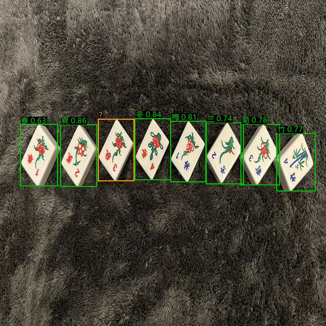
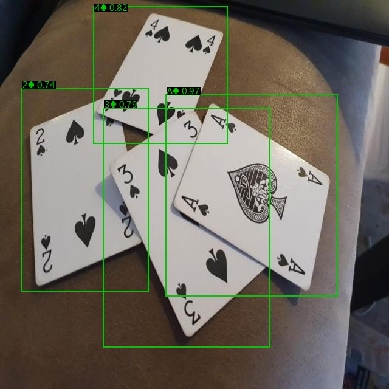

# 楹诲皢 / 鎵戝厠鐗岃瘑鍒ā鍨?
> M08 路 bga4e
> 鍩轰簬 `02_Face_recognition_project` 鐨?ESP-DL 鎺ㄧ悊妗嗘灦锛岃ˉ榻愩€屾暟鎹?鈫?鏍囨敞淇 鈫?璁粌 鈫?閲忓寲/瀵煎嚭銆嶆暣鏉￠摼璺€?
---

## 0. 涓€鍙ヨ瘽鎬荤粨

鐢ㄥ叕寮€鐨勬墤鍏?/ 楹诲皢妫€娴嬫暟鎹泦璁粌浜嗕竴濂?**涓ょ骇璇嗗埆娴佹按绾?*锛?
```
鎽勫儚澶村浘鍍?   鈹?   鈹溾攢 鈶?妫€娴嬪櫒锛圷OLOv8n锛? 绫伙細楹诲皢鐗?/ 鎵戝厠鐗岋級鈫?鐗岀殑浣嶇疆
   鈹?   鈹溾攢 鈶?鎸夋娴嬫瑁佸壀 鈫?鍒嗙被鍣紙楹诲皢 42 绫?/ 鎵戝厠 52 绫伙級
   鈹?   鈹斺攢 鈶?杈撳嚭銆?涓囥€嶃€孉鈾犮€嶇瓑鍏蜂綋鐗屽悕
```

妫€娴嬪櫒涓庡垎绫诲櫒鍧囧湪 PC 涓婅缁冨畬鎴愶紝鍙鍑?ONNX / int8锛屽苟鎸?`02_Face_recognition_project` 涓?ESP-DL 鐨勬柟寮忚縼绉诲埌 ESP32-S3銆?
## 0.1 鐩存帴鐑у綍锛圗SP32-S3锛?
浠撳簱閲岀殑 `firmware_app/` 鏄畬鏁?ESP-IDF 宸ョ▼锛屾ā鍨?int8 绯绘暟宸茬紪杩?`main/model/`锛?
```bash
git clone https://github.com/qsyyk-z/bga4e.git
cd bga4e/firmware_app
idf.py set-target esp32s3
idf.py build
idf.py -p COMx flash monitor
```

鐢ㄦ硶锛氭妸**涓€寮犵墝鏀惧湪鐢婚潰涓ぎ**锛堣窛绂?10鈥?0 cm锛夛紝灞忓箷鏄剧ず璇嗗埆缁撴灉锛?*鐭寜 BOOT** 鍒囨崲楹诲皢/鎵戝厠锛?*闀挎寜 BOOT** 鏄剧ず/闅愯棌缃俊搴︺€?
> 鏁版嵁闆嗗浘鍍忎笉闅忎粨搴撳垎鍙戯紝`datasets/` 鍙繚鐣?`meta/`锛涢渶瑕佸鐜拌缁冩椂鎸夌 3銆? 鑺傝剼鏈粠鍘熷 `鎵戝厠/楹诲皢` 鐩綍閲嶅缓銆?
## 0.2 鐗屽眬鍚庣涓?LLM 鍔╂墜

`backend/` 瀵瑰簲寮€棰樻姤鍛娿€岀畻娉曞拰宸ョ▼閮ㄥ垎銆嶇殑绗?2銆? 椤癸細

- **绗?2 椤?*锛氱墝灞€鐘舵€佸悗绔€佸疄鏃跺睍绀恒€佸鐩橈紝骞朵笌 ESP32 璇嗗埆缁撴灉杩炴帴锛?- **绗?4 椤?*锛氭帴鍏?LLM锛屽熀浜庡綋鍓嶇墝灞€缁欏嚭鎵撶墝寤鸿锛堟棤 API Key 鏃惰嚜鍔ㄤ娇鐢ㄦ湰鍦板悜鍚?杩涘紶瑙勫垯锛夈€?
```powershell
cd M08\bga4e\backend
.\.venv\Scripts\python.exe -m uvicorn app.main:app --host 0.0.0.0 --port 8000
```

鎵撳紑 <http://127.0.0.1:8000>锛岀偣鍙充笂瑙掆€滅敓鎴愭紨绀虹墝灞€鈥濆嵆鍙湅鍒板畬鏁寸墝妗屻€佷簨浠舵祦銆佸鐩樺拰绛栫暐寤鸿銆傝缁嗚鏄庤 [`backend/README.md`](backend/README.md)銆?
璁惧绔鏋滀娇鐢ㄥ皬鏅猴紙`AiXiaoZhi_Hiwonder_Sensor`锛寈iaoZhi 1.8.9锛孍SP-IDF 5.4.4 鍙紪璇戯級鍋氳闊?LLM锛屾寜 [`xiaozhi/README.md`](xiaozhi/README.md) 鎶?`mahjong_mcp.cc` 鎷疯繘鍘伙紱灏忔櫤浼氶€氳繃 MCP 宸ュ叿璋冪敤鍚庣鐨?`get_state/get_advice/set_hand/record_discard`锛岀敱灏忔櫤鐨?LLM 璐熻矗璇磋瘽銆佸悗绔礋璐ｇ畻鐗屻€?
鍙﹀宸查€傞厤 **ESP32-S3-Touch-LCD-4.3C锛?00脳480锛?*锛氭柊澧炴澘绾?RGB 灞?GT911 瑙︽懜/CH32V003 IO 鎵╁睍浠ｇ爜鍜?`mahjong_ui.cc` LVGL 鐣岄潰锛屾妸褰撳墠鐗屽眬銆佸洓瀹跺純鐗屻€佹墜鐗屽拰绛栫暐寤鸿鐩存帴鏄剧ず鍦ㄥ紑鍙戞澘涓娿€傜敤 ESP-IDF 5.4.4 瀹炴祴缂栬瘧閫氳繃锛宐in `0x5dcdf0`锛?M app 鍒嗗尯鍓╀綑 16%銆?
---

## 1. 涓?02_Face_recognition_project 鐨勫叧绯?
`02_Face_recognition_project` 鏄竴涓?**ESP-IDF + ESP-DL 鐨勬帹鐞嗗伐绋?*锛屾湰韬笉鍖呭惈璁粌浠ｇ爜銆傚畠鎻愪緵鐨勬槸锛?
| 02 涓殑妯″潡 | 鏈」鐩殑鐢ㄦ硶 |
| --- | --- |
| `main/APP/esp_face_recognition.cpp`锛氭憚鍍忓ご閲囬泦浠诲姟銆丄I 澶勭悊浠诲姟銆侀槦鍒?浜掓枼閿併€佹寜閿姸鎬佹満 | 绔晶娴佹按绾跨粨鏋勫畬鍏ㄥ鐢細鎽勫儚澶?鈫?妫€娴?鈫?瑁佸壀 鈫?鍒嗙被 鈫?LCD 缁樺埗 |
| `components/esp-dl`锛歚dl_image.hpp`銆乣dl_layer_*`銆乣dl_layer_model.hpp` | 鍒嗙被鍣ㄧ殑绠楀瓙鍙娇鐢?ESP-DL 鍘熺敓鏀寔鐨?Conv2D / DepthwiseConv2D / ReLU / GlobalAvgPool / FC |
| `components/esp-dl/tools/quantization_tool` + `convert_tool` | 妯″瀷閲忓寲銆佺郴鏁板鍑恒€乣config.json` 瑙勮寖鐩存帴娌跨敤锛堣绗?7 鑺傦級 |
| `components/modules/ai/who_ai_utils.cpp`銆乣fb_gfx.c` | 鐢绘銆佸啓瀛楃殑鏄剧ず鍑芥暟鍙洿鎺ュ鐢?|
| `partitions-16MiB.csv` | 妯″瀷/鏁版嵁鍒嗗尯甯冨眬鍙部鐢?|

> 02 鐨勪汉鑴告祦姘寸嚎鏄€屾娴?鈫?鍏抽敭鐐?鈫?瀵归綈 鈫?鐗瑰緛 鈫?鍖归厤銆嶏紱鏈」鐩殑鐗屾祦姘寸嚎鏄€屾娴?鈫?瑁佸壀 鈫?鍒嗙被銆嶃€備袱鑰呭湪浠诲姟璋冨害銆佸唴瀛樼鐞嗐€佹樉绀哄眰涓婄粨鏋勪竴鑷达紝鍖哄埆鍙湪涓棿鐨勬ā鍨嬨€?
---

## 2. 鐩綍缁撴瀯

```
bga4e/
鈹溾攢鈹€ README.md                      # 鏈枃浠?鈹溾攢鈹€ requirements.txt
鈹溾攢鈹€ datasets/
鈹?  鈹溾攢鈹€ meta/
鈹?  鈹?  鈹溾攢鈹€ class_maps.json        # 42+52 绫诲畾涔夈€佹墤鍏嬫簮绫诲埆閲嶆槧灏勮〃
鈹?  鈹?  鈹溾攢鈹€ annotations_clean.json# 娓呮礂鍚庣殑閫愬浘鏍囨敞锛堜緵璁粌/璇勪及澶嶇敤锛?鈹?  鈹?  鈹斺攢鈹€ clean_report.json      # 娓呮礂缁熻
鈹?  鈹溾攢鈹€ det/                       # 2 绫绘娴嬫暟鎹泦锛圷OLO 鏍煎紡锛?鈹?  鈹?  鈹溾攢鈹€ images/{train,valid,test}/
鈹?  鈹?  鈹溾攢鈹€ labels/{train,valid,test}/
鈹?  鈹?  鈹斺攢鈹€ data.yaml
鈹?  鈹斺攢鈹€ cls/                       # 鍒嗙被瑁佸壀鍥撅紙112脳112锛?鈹?      鈹溾攢鈹€ mahjong/{train,valid,test}/00..41/
鈹?      鈹斺攢鈹€ poker/{train,valid,test}/00..51/
鈹溾攢鈹€ scripts/
鈹?  鈹溾攢鈹€ 00_check_env.py
鈹?  鈹溾攢鈹€ 01_inspect_data.py         # 鍘熷鏁版嵁浣撴 + 鍙鍖?鈹?  鈹溾攢鈹€ 10_prepare_dataset.py      # 娓呮礂銆佹墤鍏嬮噸鏄犲皠銆佺敓鎴愭娴?鍒嗙被鏁版嵁
鈹?  鈹溾攢鈹€ 12_train_detector.py       # YOLOv8n 2 绫绘娴嬪櫒
鈹?  鈹溾攢鈹€ 13_train_classifier.py     # 楹诲皢/鎵戝厠鍒嗙被鍣?鈹?  鈹溾攢鈹€ 14_autolabel.py            # 妯″瀷杈呭姪琛ユ爣娉?鈹?  鈹溾攢鈹€ 15_eval_pipeline.py        # 妫€娴?鍒嗙被绔埌绔瘎浼?鈹?  鈹溾攢鈹€ 16_quantize_onnx.py        # ONNX int8 閲忓寲锛圥C 楠岃瘉锛?鈹?  鈹溾攢鈹€ 17_predict_image.py        # 鍗曞浘妫€娴?鍒嗙被 demo
鈹?  鈹溾攢鈹€ 18_summary.py              # 姹囨€绘寚鏍?鈹?  鈹溾攢鈹€ 19_eval_export.py          # 浠?checkpoint 璇勪及/瀵煎嚭
鈹?  鈹溾攢鈹€ 20_export_espdl_package.py # 鎵撻儴缃插寘
鈹?  鈹溾攢鈹€ 21_quantize_espdl.py       # ESP-DL 瀹樻柟閲忓寲锛圥ython 3.7锛?鈹?  鈹溾攢鈹€ cardnet.py                 # 鍒嗙被缃戠粶瀹氫箟
鈹?  鈹溾攢鈹€ cardtools.py               # 鎺ㄧ悊/璇勪及鍏辩敤鍑芥暟
鈹?  鈹斺攢鈹€ run_all.ps1                # 涓€閿祦绋?鈹溾攢鈹€ datasets/meta/                 # 绫诲埆鏄犲皠銆佹竻娲楁爣娉紙det/cls 鍥惧儚涓嶅叆搴擄紝鑴氭湰閲嶅缓锛?鈹溾攢鈹€ backend/                       # 鐗屽眬璁板綍 / 灞曠ず / 澶嶇洏 / LLM 绛栫暐鍚庣
鈹?  鈹溾攢鈹€ README.md                  # 鍚姩銆丄PI銆佽瘑鍒帴鍏ャ€丩LM 閰嶇疆
鈹?  鈹溾攢鈹€ app/                       # FastAPI + SQLite + 楹诲皢鐘舵€佹満 + 鍚戝惉/LLM
鈹?  鈹溾攢鈹€ static/                    # 鏃犳瀯寤轰緷璧栫殑缃戦〉鐗屾
鈹?  鈹溾攢鈹€ tools/serial_bridge.py     # ESP32 涓插彛璇嗗埆缁撴灉 -> 鍚庣
鈹?  鈹斺攢鈹€ tests/                     # pytest锛?5 椤癸級
鈹溾攢鈹€ xiaozhi/                       # 灏忔櫤 ESP32 MCP + 4.3C LVGL 鐣岄潰
鈹?  鈹溾攢鈹€ README.md                  # 鎷疯礉銆並config銆佸垎鍖鸿〃銆佺紪璇戞楠?鈹?  鈹溾攢鈹€ main/boards/common/        # mahjong_mcp.cc / mahjong_ui.cc
鈹?  鈹溾攢鈹€ main/boards/waveshare-s3-touch-lcd-4.3c/
鈹?  鈹斺攢鈹€ components/custom_io_expander_ch32v003/
鈹溾攢鈹€ firmware_app/                  # 瀹屾暣 ESP-IDF 宸ョ▼锛堝彲鐩存帴 idf.py build/flash锛?鈹?  鈹溾攢鈹€ README.md                  # 鐑у綍/鎸夐敭/鏍囩璇存槑
鈹?  鈹溾攢鈹€ main/APP/esp_card_recognition.cpp
鈹?  鈹溾攢鈹€ main/model/                # 涓や唤 int8 绯绘暟 + ESP-DL C++ 妯″瀷
鈹?  鈹斺攢鈹€ components/                # BSP銆佹憚鍍忓ご銆丩CD銆丒SP-DL锛堟潵鑷?02 宸ョ▼锛?鈹溾攢鈹€ firmware/
鈹?  鈹溾攢鈹€ README.md                  # 閮ㄧ讲鍖呰鏄?鈹?  鈹溾攢鈹€ mahjong/                   # ONNX銆乮nt8銆丒SP-DL 绯绘暟銆丆++ 妯″瀷
鈹?  鈹斺攢鈹€ poker/
鈹溾攢鈹€ models/
鈹?  鈹溾攢鈹€ pretrained/yolov8n.pt
鈹?  鈹溾攢鈹€ detector/                  # best.pt / best_320.onnx / best_640.onnx / metrics.json
鈹?  鈹?  鈹斺攢鈹€ auto/                  # 琛ユ爣寰皟鐗堬紙瀵规瘮鐢紝鏈綔涓烘渶缁堟ā鍨嬶級
鈹?  鈹溾攢鈹€ classifier_mahjong/        # best.pt / classifier.onnx / classifier_int8.onnx / classes.json / metrics.json
鈹?  鈹斺攢鈹€ classifier_poker/
鈹溾攢鈹€ runs/                          # 璁粌鏃ュ織銆佹洸绾裤€佹贩娣嗙煩闃?鈹斺攢鈹€ report/
    鈹溾攢鈹€ 璁粌鎶ュ憡.md
    鈹溾攢鈹€ metrics_summary.md
    鈹溾攢鈹€ audit_raw.json
    鈹溾攢鈹€ autolabel.json             # 鑷姩琛ユ爣娓呭崟锛?25 涓柊妗嗭級
    鈹溾攢鈹€ mahjong_class_sheets/      # 42 绫讳汉宸ユ牳瀵瑰浘
    鈹溾攢鈹€ poker_class_sheets/        # 鎵戝厠绫诲埆鏍稿鍥?    鈹溾攢鈹€ det/                       # 妫€娴嬪櫒鏇茬嚎/娣锋穯鐭╅樀
    鈹斺攢鈹€ pipeline_metrics.json
```

---

## 3. 鏁版嵁鏉ユ簮涓庢爣娉ㄤ慨澶嶏紙鏈」鐩殑涓昏宸ヤ綔涔嬩竴锛?
### 3.1 鍘熷鏁版嵁

| 鏁版嵁闆?| 浣嶇疆 | 鍥剧墖 | 鍘熷妗?| 绫诲埆 | 鏍囨敞鏍煎紡 |
| --- | --- | ---: | ---: | ---: | --- |
| 鎵戝厠锛圧oboflow 100锛?| `鎵戝厠/poker_yolo_real` | 1,285 | 5,574 | 53锛堝惈鑴忕被 `59`锛?| YOLO txt |
| 楹诲皢锛堢湡瀹炴媿鎽勶級 | `楹诲皢/mahjong_yolo_real` | 3,713 | 53,687 | 42锛?*鏃?data.yaml** | YOLO txt |

鍘熷鏁版嵁娌℃湁銆岀己鏍囩鏂囦欢 / 绌烘爣绛炬枃浠躲€嶏紱闂闆嗕腑鍦?**绫诲埆浣撶郴** 涓?**妗嗙殑璐ㄩ噺**锛?
### 3.2 鍙戠幇鐨勯棶棰?
1. **楹诲皢娌℃湁绫诲埆鍚?*锛?2 涓被鍒彿娌℃湁浠讳綍鏄犲皠锛屾棤娉曡缁冨垎绫诲櫒銆?2. **楹诲皢瀛樺湪鏁存帓 / 澶氬紶鐗岀矘杩炵殑澶ф**锛?,032 涓闈㈢Н瓒呰繃 5%锛堜緥濡備竴鏁存帓 14 寮犵墝琚爣鎴?1 涓锛夛紝浼氫弗閲嶅共鎵版娴嬨€?3. **楹诲皢闀垮姣斿紓甯告**锛?,926 涓鐨勫楂樻瘮涓嶅湪 [0.22, 1.55]锛屽涓烘í鍚戦暱鏉?婕忔爣銆?4. **閲嶅妗?*锛?7 涓畬鍏ㄩ噸澶嶇殑妗嗭紱鏋佸皬妗?12 涓€?5. **鎵戝厠绫诲埆绱㈠紩鏁翠綋閿欎綅**锛歒OLO 瀵煎嚭鐨勭被鍒?0鈥?8 瀹為檯鏄€屼笅涓€寮犵墝銆嶏紝渚嬪 `0=10鈾銆乣1=10鈾燻銆乣2=10鈾銆乣3=2鈾鈥︹€︼紝鑰?`20`锛堣剰绫?`59`锛夐噷鏀剧殑鍏跺疄鏄?`10鈾銆傜洿鎺ユ寜 `data.yaml` 璁粌浼氭妸鐗屽悕鏁翠綋瀛﹂敊銆?6. **鎵戝厠鐨?1 涓櫔澹版**锛氭簮绫诲埆 `19` 鍙湁 1 涓锛屽唴瀹规槸涓€寮?J鈾︼紝灞炰簬閿欐爣銆?
> 杩欎簺闂涓嶆槸闈犮€屽璁嚑涓?epoch銆嶈兘瑙ｅ喅鐨勶紝蹇呴』鍏堜慨鏁版嵁銆?
### 3.3 楹诲皢绫诲埆鍙?鈫?鐗屽悕锛堜汉宸ラ€愮被鏍稿锛?
鍘熷鏁版嵁娌℃湁绫诲埆鍚嶃€傚仛娉曟槸锛氬姣忎釜绫诲埆閲囨牱 4鈥? 寮犺鍓浘锛屾嫾鎴?contact sheet锛岄€愮被鐩纭锛堣 `report/mahjong_class_sheets/big_*.png`銆乣zoom_flowers_honors.png`锛夈€傛渶缁堟槧灏勶細

| 绫诲埆鍙?| 鐗屽悕 | 绫诲埆鍙?| 鐗屽悕 | 绫诲埆鍙?| 鐗屽悕 |
| ---: | --- | ---: | --- | ---: | --- |
| 0 | 1鏉?| 15 | 4鏉?| 30 | 8涓?|
| 1 | 1涓?| 16 | 4涓?| 31 | 8绛?|
| 2 | 1绛?| 17 | 4绛?| 32 | 9鏉?|
| 3 | 姊?| 18 | 绔?| 33 | 9涓?|
| 4 | 鏄?| 19 | 鍐?| 34 | 9绛?|
| 5 | 2鏉?| 20 | 5鏉?| 35 | 涓?|
| 6 | 2涓?| 21 | 5涓?| 36 | 鍙?|
| 7 | 2绛?| 22 | 5绛?| 37 | 鍖?|
| 8 | 鍏?| 23 | 6鏉?| 38 | 涓?|
| 9 | 澶?| 24 | 6涓?| 39 | 鍗?|
| 10 | 3鏉?| 25 | 6绛?| 40 | 鐧?|
| 11 | 3涓?| 26 | 7鏉?| 41 | 瑗?|
| 12 | 3绛?| 27 | 7涓?| | |
| 13 | 鑿?| 28 | 7绛?| | |
| 14 | 绉?| 29 | 8鏉?| | |

娉ㄦ剰鑺辩墝鏄€屾鐗?+ 瀛ｈ妭銆嶄氦鏇挎帓鍒楃殑锛歚姊?鏄ャ€佸叞/澶忋€佽強/绉嬨€佺/鍐琡锛屼笉鏄父瑙佺殑銆屾鍏扮鑿娿€嶈繛缁帓鍒楋紱瀛楃墝椤哄簭涔熸槸 `涓溿€佸彂銆佸寳銆佷腑銆佸崡銆佺櫧銆佽タ`銆傝繖浜涢兘浠ュ疄闄呭浘鍍忔牳瀵逛负鍑嗐€?
### 3.4 鎵戝厠绫诲埆閿欎綅涓庝慨澶?
鐢ㄣ€岄€愮被浠ｈ〃鍥俱€嶄笌 COCO 鍘熷鏍囨敞浜ゅ弶楠岃瘉鍚庯紝纭 YOLO 绫诲埆涓庣湡瀹炵墝闈㈢殑鍏崇郴涓猴細

```
婧愮被鍒?0  鈫?10鈾?     婧愮被鍒?10 鈫?3鈾?      婧愮被鍒?20(59) 鈫?10鈾?婧愮被鍒?1  鈫?10鈾?     婧愮被鍒?11 鈫?4鈾?      婧愮被鍒?21 鈫?6鈾?婧愮被鍒?2  鈫?10鈾?     婧愮被鍒?12 鈫?4鈾?      婧愮被鍒?22 鈫?6鈾?婧愮被鍒?3  鈫?2鈾?      婧愮被鍒?13 鈫?4鈾?      ...
婧愮被鍒?4  鈫?2鈾?      婧愮被鍒?14 鈫?4鈾?      婧愮被鍒?52 鈫?Q鈾?婧愮被鍒?5  鈫?2鈾?      婧愮被鍒?15 鈫?5鈾?婧愮被鍒?6  鈫?2鈾?      婧愮被鍒?16 鈫?5鈾?婧愮被鍒?7  鈫?3鈾?      婧愮被鍒?17 鈫?5鈾?婧愮被鍒?8  鈫?3鈾?      婧愮被鍒?18 鈫?5鈾?婧愮被鍒?9  鈫?3鈾?      婧愮被鍒?19 鈫?涓㈠純锛? 涓?J鈾?鍣０妗嗭級
```

鍘熷 53 绫?鈫?淇鍚?**52 绫?*锛?2 寮犳爣鍑嗙墝锛屼笉鍚ぇ灏忕帇锛夈€傚畬鏁存槧灏勮 `datasets/meta/class_maps.json` 鐨?`poker.src_to_idx`銆?
### 3.5 娓呮礂瑙勫垯涓庣粨鏋?
| 瑙勫垯 | 楹诲皢 | 鎵戝厠 |
| --- | ---: | ---: |
| 闈㈢Н < 闃堝€?| 12 | 0 |
| 闈㈢Н > 闃堝€硷紙鏁存帓/澶氱墝绮樿繛锛?| 4,032 | 0 |
| 闀垮姣斿紓甯?| 1,926 | 22 |
| 瀹屽叏閲嶅 | 37 | 0 |
| 绫诲埆鍣０妗?| 0 | 1 |
| **淇濈暀妗嗘暟** | **47,680** | **5,551** |

娓呮礂鍚庯細
- 妫€娴嬮泦锛歵rain 3,716 寮狅紙楹诲皢 2,752 + 鎵戝厠 964锛夈€乿alid 504 寮狅紙311 + 193锛夈€乼est 295 寮狅紙167 + 128锛夈€?- 鍒嗙被瑁佸壀锛歵rain 45,083 寮犮€乿alid 5,245 寮犮€乼est 2,903 寮犮€?
### 3.6 妯″瀷杈呭姪琛ユ爣娉?
瑙勫垯娓呮礂浼氭妸銆屾暣鎺掔矘杩炵殑澶ф銆嶆暣鍧楀垹鎺夛紝瀵艰嚧杩欎簺鐗屾殏鏃舵病鏈夋爣绛俱€俙scripts/14_autolabel.py` 鐢ㄧ涓€鐗堟娴嬪櫒 + 鍒嗙被鍣ㄥ仛鍗婅嚜鍔ㄨˉ鏍囷細

1. 鍦ㄨ缁?楠岃瘉闆嗕笂浠?`conf=0.25` 鎺ㄧ悊锛?2. 涓庡凡鏈?GT 鍋?IoU 鍖归厤锛屾湭鍖归厤鐨勯珮鍒嗛娴嬩綔涓哄€欓€夛紱
3. 鍒嗙被缃俊搴?鈮?0.85 鎵嶅啓鍏?`datasets/det_auto/`锛?4. 杈撳嚭 `report/autolabel.json` 涓?`report/autolabel_preview.jpg` 渚涗汉宸ユ娊鏌ャ€?
> 璇ユ楠?*涓嶈鐩栧師濮嬫暟鎹?*锛宍det_auto` 鏄€屾竻娲?GT + 鑷姩琛ユ銆嶇殑鏂版暟鎹泦锛屽彲閫夌敤瀹冨啀寰皟妫€娴嬪櫒銆?
鏈瀹為檯杩愯缁撴灉锛坄report/autolabel.json`锛夛細

| 椤?| 楹诲皢 | 鎵戝厠 |
| --- | ---: | ---: |
| 鍥犳暣鎺掓琚竻绌恒€佹湰娆℃仮澶嶇殑鍥剧墖 | 457 | 0 |
| GT 琚娴嬪櫒鍖归厤 | 44,638 / 45,330锛?8.5%锛?| 4,978 / 4,998锛?9.6%锛?|
| 鏂板鏍囨敞妗?| 823 | 2 |

`datasets/det_auto` 璁粌闆?4,114 寮狅紙姣旀竻娲楃増澶?457 寮狅級銆傜敤瀹冧粠 v1 寰皟 12 epoch 鍚庯紝test mAP50-95 涓?0.7935锛坴1 涓?0.7931锛夛紝浣?precision/recall 鐣ヤ綆锛?.987/0.973 vs 0.993/0.976锛夛紝鍥犳鏈€缁堜粛閲囩敤 v1锛屽井璋冩ā鍨嬪瓨妗ｅ湪 `models/detector/auto/`銆?
---

## 4. 绫诲埆浣撶郴

- **楹诲皢 42 绫?*锛?鈥? 鏉?/ 涓?/ 绛掞紙27锛? 8 寮犺姳鐗?+ 7 寮犲瓧鐗?= 42銆?- **鎵戝厠 52 绫?*锛?鈥?0銆丣銆丵銆並銆丄 脳 鈾︹櫏鈾犫櫍 = 52锛堜笉鍚ぇ灏忕帇锛夈€?- 鍒嗙被鍣ㄨ緭鍑虹储寮曚笌绫诲埆鍚嶇殑瀵瑰簲鍏崇郴淇濆瓨鍦細
  - `models/classifier_mahjong/classes.json`
  - `models/classifier_poker/classes.json`

---

## 5. 妯″瀷涓庤缁?
### 5.1 妫€娴嬪櫒

| 椤?| 鍊?|
| --- | --- |
| 缁撴瀯 | YOLOv8n锛圕OCO 棰勮缁冿級 |
| 杈撳叆 | 640脳640 |
| 绫诲埆 | 2锛歚mahjong_tile`銆乣poker_card` |
| 璁粌杞暟 | 40锛堟棭鍋?patience=20锛?|
| 浼樺寲 | AdamW锛圲ltralytics auto锛夛紝AMP |
| 澧炲己 | mosaic銆乵ixup銆丠SV銆伮?掳 鏃嬭浆銆佸钩绉汇€佺缉鏀俱€侀€忚 |

### 5.2 鍒嗙被鍣?
| 椤?| 鍊?|
| --- | --- |
| 缁撴瀯 | 娣卞害鍙垎绂?CNN锛圡obileNetV1 椋庢牸锛屾棤娈嬪樊锛?|
| 杈撳叆 | 96脳96 RGB锛屽綊涓€鍖栧埌 [-1, 1] |
| 鍙傛暟閲?| 绾?0.31 M锛坕nt8 绾?0.3 MB锛?|
| 杈撳嚭 | 楹诲皢 42 / 鎵戝厠 52 |
| 鎹熷け | CrossEntropy + label smoothing 0.1 |
| 閲囨牱 | `WeightedRandomSampler`锛?/鈭氱被鍒娆★級锛岀紦瑙ｈ姳鐗屾牱鏈皯 |
| 澧炲己 | 闅忔満鏃嬭浆锛堟墤鍏?卤180掳锛岄夯灏?90掳 鍊嶆暟 + 卤12掳锛夈€侀殢鏈鸿鍓€侀€忚銆侀鑹叉姈鍔ㄣ€侀殢鏈烘摝闄?|
| 浼樺寲 | AdamW锛宭r 3e-3锛宑osine锛岄夯灏?35 epoch / 鎵戝厠 45 epoch |

> 楹诲皢璁粌鍦ㄧ害 30 epoch 鏃跺洜 Windows 澶氳繘绋?DataLoader 璧勬簮闂涓柇锛宐est 鍑虹幇鍦?epoch 11锛屼箣鍚庣敤 `19_eval_export.py` 浠?best.pt 瀹屾垚娴嬭瘯涓庡鍑猴紱缁撴灉涓嶅彈褰卞搷銆?
閫夋嫨璇ョ粨鏋勭殑鍘熷洜锛氬彧浣跨敤 Conv2D / DepthwiseConv2D / ReLU / GlobalAvgPool / FC锛?*鍏ㄩ儴鏄?ESP-DL 1.x 鍘熺敓鏀寔鐨勭畻瀛?*锛屾柟渚垮悗缁噺鍖栦笌鎵嬪啓 C++ 妯″瀷銆?
### 5.3 鐜

- Windows 10/11锛孭ython 3.10
- PyTorch 2.5.1 + CUDA 12.1锛宼orchvision 0.20.1
- Ultralytics 8.4.x
- GPU锛歊TX 4060 Laptop 8 GB锛圕PU 涔熷彲璺戯紝浣嗘娴嬪櫒浼氭參寰堝锛?
瀹夎锛?
```powershell
py -3.10 -m venv .venv
.\.venv\Scripts\python.exe -m pip install torch==2.5.1+cu121 torchvision==0.20.1+cu121 --index-url https://download.pytorch.org/whl/cu121
.\.venv\Scripts\python.exe -m pip install ultralytics opencv-python onnx onnxruntime
```

### 5.4 澶嶇幇鍛戒护

```powershell
# 0) 鐜鑷
.\.venv\Scripts\python.exe scripts\00_check_env.py

# 1) 娓呮礂 + 閲嶆槧灏?+ 瑁佸壀锛堢害 3鈥? 鍒嗛挓锛?.\.venv\Scripts\python.exe scripts\10_prepare_dataset.py --workers 8

# 2) 璁粌妫€娴嬪櫒锛堢害 30鈥?0 鍒嗛挓锛孯TX 4060锛?.\.venv\Scripts\python.exe scripts\12_train_detector.py --epochs 40 --imgsz 640 --batch 16 --workers 8 --cache ram --project runs\det

# 3) 璁粌鍒嗙被鍣?.\.venv\Scripts\python.exe scripts\13_train_classifier.py --domain mahjong --epochs 35
.\.venv\Scripts\python.exe scripts\13_train_classifier.py --domain poker   --epochs 45

# 4) 妯″瀷杈呭姪琛ユ爣娉紙鍙€夛級
.\.venv\Scripts\python.exe scripts\14_autolabel.py

# 5) 绔埌绔瘎浼?.\.venv\Scripts\python.exe scripts\15_eval_pipeline.py --conf 0.35

# 6) int8 閲忓寲锛圤NNX Runtime锛孭C 楠岃瘉锛?.\.venv\Scripts\python.exe scripts\16_quantize_onnx.py --domain mahjong
.\.venv\Scripts\python.exe scripts\16_quantize_onnx.py --domain poker

# 7) ESP-DL 閲忓寲锛圥ython 3.7 鐜锛屽鍑?ESP32-S3 绯绘暟锛?.\.venv37\Scripts\python.exe scripts\21_quantize_espdl.py --domain mahjong
.\.venv37\Scripts\python.exe scripts\21_quantize_espdl.py --domain poker

# 8) 姹囨€绘寚鏍?/ 瀵煎嚭閮ㄧ讲鍖?.\.venv\Scripts\python.exe scripts\18_summary.py
.\.venv\Scripts\python.exe scripts\20_export_espdl_package.py --domain mahjong
.\.venv\Scripts\python.exe scripts\20_export_espdl_package.py --domain poker
```

> 璺緞鍚腑鏂囨椂锛孫penCV 鐨?`imread` 浼氬け璐ャ€俇ltralytics 8.4 宸插唴缃璇█鏂囦欢鍚嶆敮鎸侊紱鑻ヤ綘浣跨敤鏇磋€佺殑鐗堟湰锛屽缓璁厛寤虹珛 ASCII 鐩綍鑱旀帴锛?> `cmd /c mklink /J D:\cardrecog "D:\澶у\鍒堕€犲伐绋嬩綋楠?`锛岀劧鍚庡湪 `D:\cardrecog\...` 涓嬭繍琛屻€?
---

## 6. 缁撴灉

> 浠ヤ笅鏁板瓧鐢辨湰浠撳簱鑴氭湰瀹為檯璺戝嚭锛岃缁嗘洸绾?娣锋穯鐭╅樀瑙?`runs/` 涓?`report/`銆?
### 6.1 妫€娴嬪櫒锛圷OLOv8n锛? 绫伙級

| 鎸囨爣 | 鍊?|
| --- | ---: |
| Precision | 0.9934 |
| Recall | 0.9756 |
| mAP50 | **0.9866** |
| mAP50-95 | **0.7931** |

| 绫诲埆 | mAP50 | mAP50-95 |
| --- | ---: | ---: |
| 楹诲皢鐗?| 0.9782 | 0.7562 |
| 鎵戝厠鐗?| 0.9950 | 0.8300 |

鏇茬嚎涓庢贩娣嗙煩闃碉細`report/det/results.png`銆乣report/det/BoxPR_curve.png`銆乣report/det/confusion_matrix_normalized.png`銆?
### 6.2 楹诲皢鍒嗙被鍣紙42 绫伙級

| 鎸囨爣 | 鍊?|
| --- | ---: |
| best val top-1 | 0.9689 |
| test top-1 | **0.9753** |
| test top-3 | **0.9962** |
| test 鏍锋湰 | 2,350 |
| int8 top-1 | 0.9745 |
| int8 澶у皬 | 360.9 KB |

娣锋穯鐭╅樀锛歚models/classifier_mahjong/confusion_test.png`銆?
### 6.3 鎵戝厠鍒嗙被鍣紙52 绫伙級

| 鎸囨爣 | 鍊?|
| --- | ---: |
| best val top-1 | 0.8002 |
| test top-1 | **0.7866** |
| test top-3 | **0.9638** |
| test 鏍锋湰 | 553 |
| int8 top-1 | 0.7794 |
| int8 澶у皬 | 366.0 KB |

> 鎵戝厠鏁版嵁闆嗙殑鏍囨敞鍣０鏄庢樉楂樹簬楹诲皢锛堥儴鍒嗘鐢诲埌鐩搁偦鐗屼笂锛夛紝鍥犳鍑嗙‘鐜囦綆浜庨夯灏嗭紱璇﹁ `report/璁粌鎶ュ憡.md`銆?
### 6.4 绔埌绔?
| 鎸囨爣 | 楹诲皢 | 鎵戝厠 | 鍚堣 |
| --- | ---: | ---: | ---: |
| GT 妗嗘暟 | 2,350 | 553 | 2,903 |
| 妫€鍑虹巼 | 0.9596 | 0.9964 | 0.9666 |
| 妫€鍑烘鍒嗙被姝ｇ‘鐜?| 0.9818 | 0.7913 | 鈥?|
| 绔埌绔纭巼 | **0.9421** | **0.7884** | **0.9128** |

鍙鍖栵細`report/pipeline_*.jpg`銆?
楹诲皢绀轰緥锛堣姳鐗岃锛岀涓夊紶 `绉媊 缃俊搴︿綆琚爣鎴?`?`锛夛細



鎵戝厠绀轰緥锛坄3鈾燻 琚鍒や负 `3鈾锛屽叾浣欐纭級锛?


---

## 7. 瀵煎嚭涓?ESP32-S3 閮ㄧ讲

### 7.1 宸插鍑烘枃浠?
| 鏂囦欢 | 璇存槑 |
| --- | --- |
| `models/detector/best.pt` | 妫€娴嬪櫒 PyTorch 鏉冮噸 |
| `models/detector/best_320.onnx` | 320脳320 闈欐€?ONNX锛岄€傚悎绔晶 |
| `models/detector/best_640.onnx` | 640脳640 闈欐€?ONNX锛岀簿搴﹀弬鑰?|
| `models/classifier_mahjong/classifier.onnx` | 楹诲皢鍒嗙被 FP32 ONNX锛岃緭鍏?`[1,3,96,96]` |
| `models/classifier_mahjong/classifier_int8.onnx` | 楹诲皢 int8 ONNX锛坧er-channel锛?|
| `models/classifier_poker/classifier.onnx` | 鎵戝厠鍒嗙被 FP32 ONNX |
| `models/classifier_poker/classifier_int8.onnx` | 鎵戝厠 int8 ONNX |
| `firmware/mahjong/espdl_coeff/card_cls.cpp/.hpp` | **ESP-DL int8 绯绘暟**锛堝畼鏂?Calibrator 瀵煎嚭锛?|
| `firmware/mahjong/card_classifier_model.hpp` | **ESP-DL C++ 妯″瀷绫?*锛堥夯灏嗭級 |
| `firmware/poker/espdl_coeff/card_cls.cpp/.hpp` | ESP-DL int8 绯绘暟锛堟墤鍏嬶級 |
| `firmware/poker/card_classifier_model.hpp` | ESP-DL C++ 妯″瀷绫伙紙鎵戝厠锛?|

### 7.2 鎺ュ埌 02 宸ョ▼涓婄殑鎺ㄨ崘璺緞

1. **妫€娴?*锛氫紭鍏堢敤 `ColorDetector`锛圗SP-DL 鑷甫锛夋壘鐧借壊/褰╄壊鐗岄潰鍖哄煙锛屾寜闈㈢Н銆侀暱瀹芥瘮杩囨护锛涜嫢鍏夌収澶嶆潅锛屽啀鎶?YOLOv8n 鎹㈡垚 ESP-DL 鏀寔鐨勬娴嬪ご锛屾垨鍏堢敤棰滆壊娉曞畾浣嶃€?2. **瑁佸壀 + 缂╂斁**锛氱敤 `dl_image.hpp` 鐨?`resize` / `crop`锛屾妸鐗岄潰缂╂斁鍒?96脳96锛孯GB888 鈫?褰掍竴鍖栥€?3. **鍒嗙被**锛氭寜 `components/esp-dl/tutorial/quantization_tool_example` 鐨勫啓娉曪紝鐢?`dl::layer::Conv2D` / `DepthwiseConv2D` / `GlobalAvgPool2D` / `FullyConnected` 鎼嚭 `CardNet`锛岀郴鏁扮敱閲忓寲宸ュ叿瀵煎嚭銆?4. **鏄剧ず**锛氭妸鍒嗙被缁撴灉锛坄3涓嘸銆乣A鈾燻锛夐€氳繃 `fb_gfx_print` 鐢诲湪 LCD 涓婏紝妫€娴嬫鐢?`who_ai_utils.cpp` 鐨?`draw_rectangle`銆?
### 7.3 ESP-DL 閲忓寲娴佺▼锛堝凡瀹為檯璺戦€氾級

Windows 涓婂畼鏂?`.pyd` 鍙敮鎸佹棫鐗?Python锛屽凡鐢?pyenv 3.7.9 + `.venv37` 璺戦€氾細

```powershell
pyenv install 3.7.9
python -m venv .venv37
.\.venv37\Scripts\pip install numpy==1.21.6 onnx==1.9.0 onnxruntime==1.7.0 onnxoptimizer==0.2.6 protobuf==3.20.3 Pillow==9.5.0

.\.venv37\Scripts\python.exe scripts\21_quantize_espdl.py --domain mahjong
.\.venv37\Scripts\python.exe scripts\21_quantize_espdl.py --domain poker
```

鑴氭湰浼氾細

1. 鐢?`optimizer.py` 鍋?BN 鎶樺彔銆侀潤鎬?batch 杞姩鎬侊紱
2. 鍙?200 寮?`datasets/cls/<domain>/valid` 鍋氭牎鍑嗭紱
3. `Calibrator('int8', 'per-channel', 'entropy')` 鐢熸垚閲忓寲琛紱
4. `export_coefficient_to_cpp(..., 'esp32s3', ...)` 杈撳嚭 `card_cls.cpp/.hpp`銆?
瀹為檯瀵煎嚭鐨勯€愬眰鎸囨暟锛堥夯灏嗭級锛氳緭鍏?-7锛宻tem -5锛宖4.dw -3锛宧ead -5锛孎C -4锛涙墤鍏嬬暐鏈変笉鍚屻€俙firmware/*/card_classifier_model.hpp` 宸叉寜杩欎簺鎸囨暟鍐欏ソ锛屽眰椤哄簭涓?`scripts/cardnet.py` 涓€鑷达細

```
Conv3x3(3鈫?2,s2) 鈫?DW/PW(32鈫?4,s2) 鈫?DW/PW(64鈫?4,s1)
鈫?DW/PW(64鈫?6,s2) 鈫?DW/PW(96鈫?6,s1)
鈫?DW/PW(96鈫?28,s2) 鈫?DW/PW(128鈫?28,s1)
鈫?DW/PW(128鈫?92,s2) 鈫?DW/PW(192鈫?92,s1)
鈫?DW/PW(192鈫?56,s1) 鈫?Conv1x1(256鈫?12)
鈫?GlobalAvgPool 鈫?FC(512鈫扤)
```

> 璇存槑锛欳++ 妯″瀷灏氭湭鍦ㄧ湡瀹?ESP32-S3 涓婄紪璇?鐑у綍楠岃瘉锛涘眰 API 涓庢寚鏁板潎鎸夋湰浠撳簱 ESP-DL 1.x 鐨勫疄闄呭鍑虹粨鏋滅紪鍐欍€?
### 7.4 绔晶璧勬簮浼拌

| 妯″瀷 | 杈撳叆 | 鍙傛暟閲?| FP32 | int8 | 澶囨敞 |
| --- | --- | ---: | ---: | ---: | --- |
| 鍒嗙被鍣?| 96脳96脳3 | ~0.31 M | ~1.2 MB | ~0.3 MB | 鍗曞抚涓€娆?|
| 妫€娴嬪櫒 | 320脳320脳3 | ~3.0 M | ~12 MB | ~3 MB | 鑻ョ渚ц窇 YOLO锛岄渶璇勪及 Flash/PSRAM 涓庡欢杩?|

ESP32-S3 鐨?8 MB PSRAM 鍙互鍚屾椂鏀句笅妫€娴嬪櫒 + 鍒嗙被鍣紱鑻ュ彧鍋氥€岄鑹插畾浣?+ 鍒嗙被銆嶏紝鍒欏彧闇€鍒嗙被鍣ㄧ殑 ~0.3 MB銆?
---

## 8. 灞€闄愪笌鏀硅繘

1. **鎵戝厠鏍囨敞鍣０ + 绾㈡/鏂瑰潡娣锋穯**锛氬叕寮€鏁版嵁闆嗘湰韬瓨鍦ㄥ皯閲忔鐢诲埌鐩搁偦鐗屼笂鐨勬儏鍐碉紱鏈」鐩€氳繃绫诲埆閲嶆槧灏勪笌娓呮礂淇帀浜嗙郴缁熸€ч棶棰橈紝浣嗕釜鍒浠嶆湁鍣０銆傜鍒扮璇勪及涓富瑕侀敊璇槸 `A鈾モ啍A鈾銆乣6鈾モ啋6鈾銆乣5鈾︹啋5鈾 绛夌孩鑹茶姳鑹叉贩娣嗭紙96脳96 涓嬪舰鐘跺樊寮傝鍘嬬缉锛夛紝鍏舵鎵嶆槸鐐规暟銆傛妸杈撳叆鎻愰珮鍒?128 鎴栧崟鐙瑙掓爣鍋氳姳鑹插垎绫伙紝鏄笅涓€姝ユ渶鐩存帴鐨勬彁鍗囨墜娈点€?2. **楹诲皢鑺辩墝鏍锋湰灏?*锛氭瘡绫荤害 600 涓锛堝叾浠栫被 1,000+锛夛紝宸茬敤閲嶉噰鏍风紦瑙ｏ紱鑻ュ疄闄呭満鏅姳鐗屽锛屽缓璁ˉ鎷嶃€?3. **鐪熷疄鍦烘櫙宸紓**锛氭暟鎹泦澶氫负骞抽摵銆佹闈€佸厜鐓у潎鍖€鐨勫浘锛涚湡瀹炵墝妗岀殑鏂滆銆佸弽鍏夈€侀伄鎸°€佸彔鐗屼粛鏄富瑕佽宸潵婧愩€傚缓璁敤鎵嬫満鑷噰 300鈥?00 寮犲仛寰皟銆?4. **鏈寘鍚ぇ灏忕帇**锛氭墤鍏嬫暟鎹泦娌℃湁 Joker锛屾ā鍨嬭緭鍑?52 绫伙紱濡傞渶 54 绫伙紝琛?2 绫绘牱鏈悗閲嶈窇 `13_train_classifier.py --domain poker` 鍗冲彲銆?5. **绔晶妫€娴嬪櫒**锛氬綋鍓嶆娴嬪櫒鏄?YOLOv8n锛岀洿鎺ヤ笂 ESP32-S3 闇€瑕侀澶栫殑妫€娴嬪ご閫傞厤锛涙洿绋冲Ε鐨勬柟妗堟槸銆孋olorDetector 瀹氫綅 + 鏈」鐩垎绫诲櫒銆嶃€?
---

## 9. 鏁版嵁鏉ユ簮涓庤鍙?
- 鎵戝厠锛歊oboflow 100 `poker-cards-cxcvz`锛孋C BY 4.0銆?- 楹诲皢锛欻ugging Face `wzqacky/mahjong_tiles`锛堢湡瀹炴媿鎽勶級锛岃鍙浠ュ師浠撳簱椤甸潰涓哄噯銆?- 楹诲皢娓告垙绱犳潗锛歚pjura/mahjong_souls_tiles`锛堟湰椤圭洰鏈洿鎺ヤ娇鐢紝鍙綔涓鸿ˉ鍏呭垎绫绘暟鎹級銆?- 棰勮缁冩潈閲嶏細Ultralytics YOLOv8n锛孉GPL-3.0銆?
