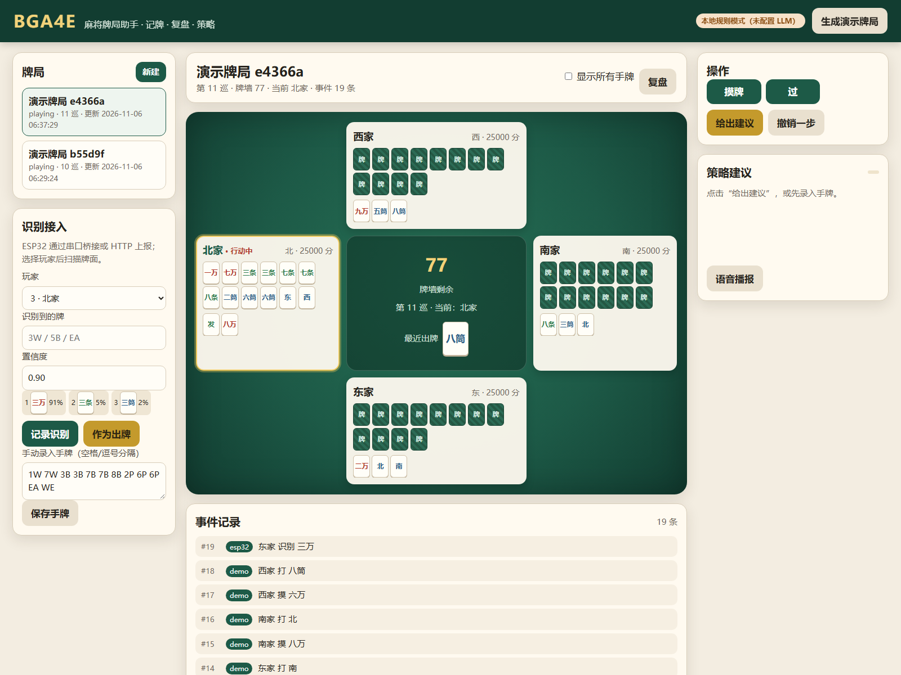

# BGA4E 牌局后端与 LLM 助手

面向麻将的“牌局记录 / 实时展示 / 复盘 / 策略建议”后端，接 ESP32-S3 的识别结果，并可选接入任意 OpenAI 兼容大模型。

对应开题报告中的：

- **算法与工程第 2 项**：记录游戏状态的后端、状态展示、复盘，并与图像识别模块连接；
- **算法与工程第 4 项**：接入 LLM，提供打牌策略建议。



## 1. 已实现的功能

| 模块 | 说明 |
| --- | --- |
| 牌局状态 | 4 人麻将：手牌、副露、弃牌、牌墙、当前玩家、庄家、分数、胜负 |
| 事件溯源 | 摸牌/出牌/碰/吃/杠/胡/过/记分/扫描/录入手牌，全部落库，可撤销、可重放 |
| 实时展示 | 浏览器牌桌、玩家手牌/副露/弃牌河、牌墙、最近出牌、事件流 |
| 复盘 | 按事件逐步回放，支持上一步/下一步/自动播放/拖动时间轴 |
| 识别接入 | `POST /api/games/{id}/recognitions`；附 ESP32 串口桥接脚本 |
| 手动纠错 | 手动录入手牌、撤销最后一步，适配识别不完美的真实场景 |
| 策略建议 | 本地向听/进张规则 + LLM；LLM 不可用时自动降级，不阻塞演示 |
| 语音 | 浏览器 `speechSynthesis` 播报建议，适配老年用户 |
| 实时推送 | WebSocket `/ws/games/{id}`，识别上报后所有页面同步刷新 |

## 2. 快速启动

```powershell
cd M08\bga4e\backend

# 已创建好的虚拟环境
.\.venv\Scripts\python.exe -m uvicorn app.main:app --host 0.0.0.0 --port 8000
```

打开 <http://127.0.0.1:8000>。右上角“生成演示牌局”可以先看完整效果。

如果要让同一局域网内的 ESP32 或手机访问，使用 `--host 0.0.0.0`，并在 Windows 防火墙放行 8000 端口。

### 依赖安装（换机器时）

```powershell
python -m venv .venv
.\.venv\Scripts\python.exe -m pip install -r requirements.txt
```

## 3. 两种使用模式

### 3.1 演示 / 手动模式

“新建”牌局时勾选“自动发牌”，系统会随机发 13 张；可以正常摸牌、出牌、碰/吃/杠/胡，适合演示和规则测试。

### 3.2 真实摄像头模式

摄像头只看到桌面上的弃牌，看不到四家手牌，因此新建牌局时：

- 取消勾选“自动发牌”；
- 系统自动关闭“严格校验手牌/轮次”（也可以手动取消）。

这样每次识别到一张打出的牌，就能记录：

```json
POST /api/games/{game_id}/recognitions
{
  "player": 0,
  "tile": "3W",
  "confidence": 0.92,
  "top3": [{"tile": "3W", "confidence": 0.92}],
  "source": "esp32"
}
```

需要给某位玩家算向听/进张时，在左侧“手动录入手牌”里输入 13 或 14 张牌（如 `1W 2W 3W 4B 5B EA`），或者调用：

```http
POST /api/games/{game_id}/hands/0
{"tiles": ["1W","2W","3W","4B","5B","EA"]}
```

后续可以把语音识别到的“我的手牌是……”接到这个接口。

## 4. 连接 ESP32 识别模块

### 4.1 固件输出

`firmware_app/main/APP/esp_card_recognition.cpp` 在每帧识别后输出：

```text
I (12345) CARD_RESULT: {"mode":"mahjong","tile":"3W","conf":0.923}
```

重新编译烧录后，串口就能看到这一行。

### 4.2 PC 串口桥接

```powershell
.\.venv\Scripts\python.exe tools\serial_bridge.py `
  --port COM5 --game <网页左侧的牌局ID> --player 0
```

脚本默认 1.5 秒内相同结果只上报一次，避免一帧一条刷屏；`--dry-run` 可以先不写后端，只打印。

### 4.3 直接 HTTP（WiFi）

如果后续给 ESP32 加 WiFi，可以直接把同样的 JSON POST 到：

```text
http://<PC 局域网 IP>:8000/api/games/<game_id>/recognitions
```

后端已开启 CORS，ESP32、手机、另一个网页都可以上报。

## 5. 接入 LLM

复制配置：

```powershell
Copy-Item .env.example .env
notepad .env
```

填入任意 OpenAI 兼容服务：

```dotenv
LLM_API_KEY=sk-...
LLM_BASE_URL=https://api.deepseek.com/v1
LLM_MODEL=deepseek-chat
```

重启服务后，右上角徽章会变成“大模型已接入”。点击“给出建议”时：

1. 本地规则先算向听、进张、候选出牌；
2. 把牌局摘要 + 规则分析交给 LLM；
3. LLM 返回 JSON：`action/tile/reason/confidence/alternatives`；
4. 后端校验建议是否合法，不合法或超时则回退到本地规则。

**没有 API Key 也能完整演示**：徽章显示“本地规则模式”，建议由向听/进张算法给出。

环境变量也支持：

```powershell
$env:LLM_API_KEY="sk-..."
$env:LLM_BASE_URL="https://api.deepseek.com/v1"
$env:LLM_MODEL="deepseek-chat"
```

## 6. API 一览

| 方法 | 路径 | 说明 |
| --- | --- | --- |
| GET | `/api/health` | 健康检查、LLM 是否配置 |
| GET | `/api/meta/tiles` | 牌代码/中文名/颜色 |
| GET | `/api/games` | 牌局列表 |
| POST | `/api/games` | 新建牌局 |
| POST | `/api/games/demo` | 生成随机演示牌局 |
| GET | `/api/games/{id}` | 当前状态 + 合法操作 |
| DELETE | `/api/games/{id}` | 删除 |
| GET | `/api/games/{id}/events` | 事件列表（`?after=seq`） |
| POST | `/api/games/{id}/events` | 追加动作事件 |
| POST | `/api/games/{id}/recognitions` | 上报识别结果（scan） |
| POST | `/api/games/{id}/hands/{player}` | 手动录入手牌 |
| POST | `/api/games/{id}/advice` | 获取策略建议 |
| POST | `/api/games/{id}/undo` | 撤销最后一条事件 |
| GET | `/api/games/{id}/replay` | 复盘快照 |
| GET | `/api/games/{id}/hand/{player}` | 单人手牌分析 |
| GET | `/api/current/summary` | 最近一局的精简状态（小智用） |
| POST | `/api/current/advice` | 最近一局的策略建议 |
| POST | `/api/current/hands/{player}` | 最近一局录入手牌 |
| POST | `/api/current/events` | 最近一局追加事件 |
| WS | `/ws/games/{id}` | 实时状态推送 |

交互式文档：<http://127.0.0.1:8000/docs>

事件类型：

```text
draw / discard / peng / chi / gang / win / pass / scan / set_hand / score
```

## 7. 目录结构

```text
backend/
├── app/
│   ├── main.py       FastAPI 路由、WebSocket、静态页面
│   ├── game.py       麻将状态机、事件应用、合法动作
│   ├── shanten.py    向听/进张/最佳出牌
│   ├── advisor.py    本地规则 + LLM + 缓存/降级
│   ├── tiles.py      牌编码、中文名、解析
│   ├── db.py         SQLite 事件存储
│   ├── schemas.py    Pydantic 请求模型
│   └── config.py     环境变量
├── static/           无构建依赖的前端（HTML/CSS/JS）
├── tools/
│   └── serial_bridge.py
├── tests/            pytest
├── docs/screenshot.png
├── requirements.txt
└── .env.example
```

## 8. 测试

```powershell
.\.venv\Scripts\python.exe -m pytest -q
```

当前覆盖：牌编码解析、向听/七对/十三幺、最佳出牌、创建牌局、摸打、撤销、复盘、识别上报、手动录入手牌、演示牌局、LLM 降级。

## 9. 小智语音 / LLM 接入

如果设备端使用 [xiaozhi-esp32](https://github.com/78/xiaozhi-esp32) 做语音交互，可以把本后端作为“牌局工具”挂到小智的 MCP 上：小智负责唤醒、ASR、LLM 对话和 TTS，后端只负责牌局状态、向听/进张和策略。

### 9.1 后端提供的“当前牌局”接口

小智设备不需要知道每局 ID，直接访问：

```text
GET  /api/current/summary?player=0     # 我的手牌、各家弃牌、牌墙、最近出牌
POST /api/current/advice               # {"player":0,"use_llm":false}
POST /api/current/hands/0              # {"tiles":["1W","2W","3W"]}
POST /api/current/events               # 记录出牌等事件
```

`use_llm=false` 时只走向听/进张规则，由小智的 LLM 负责把结果说成自然语言，避免重复调用大模型。

### 9.2 小智端 MCP 工具

在 xiaozhi 工程里新增了 `main/boards/common/mahjong_mcp.cc`，注册：

| 工具 | 作用 |
| --- | --- |
| `self.mahjong.get_state` | 获取当前牌局摘要 |
| `self.mahjong.get_advice` | 获取“打哪张/理由/向听” |
| `self.mahjong.set_hand` | 语音报手牌后录入 |
| `self.mahjong.record_discard` | 手动记录打出的牌 |

配置（`idf.py menuconfig` → `BGA4E Mahjong Assistant`）：

```text
BGA4E_BACKEND_URL  = http://<PC 局域网 IP>:8000
BGA4E_PLAYER       = 0..3
```

之后对小智说：

- “现在牌局怎么样？” → 调用 `get_state`
- “我该打哪张？” → 调用 `get_advice`
- “我的手牌是一万、二万、三万……” → 调用 `set_hand`
- “记一下，我打三万” → 调用 `record_discard`

小智的云端 LLM 会看到这些工具的说明，并决定何时调用；工具返回中文文本，TTS 直接播报。

> xiaozhi-esp32 2.2.4 的 `idf_component.yml` 要求 ESP-IDF >= 5.5.2；如果本机只有 5.4，需要安装 5.5.x 或调整该要求后再编译。

## 10. 设计说明与限制

- **事件溯源**：`events` 是唯一事实来源，`games.state_json` 只是快照；撤销/复盘都能从 `initial_json + events` 重建。
- **观察者模式**：`strict_hands=false`、`strict_turn=false` 时允许只记录桌面弃牌；手牌为空时建议接口会明确提示“先录入手牌”，不会编造。
- **当前只实现麻将状态机**。扑克状态（Texas Hold'em 的下注轮/公共牌/底池）可以复用同一套事件表和 WebSocket，但需要单独的 `poker.py`，不在本次范围内。
- **无鉴权**：这是本地演示/课程项目，默认只监听本机或局域网。公网部署前需要加登录、限流和 HTTPS。
- **LLM 隐私**：牌局摘要会发送到配置的模型服务；如果涉及真实老人数据，建议本地模型或脱敏。
- **识别接入**：当前用 PC 串口桥接，适合未烧录/调试阶段；产品化时建议 ESP32 直接 WiFi HTTP 或 MQTT，并加断线重连与本地缓存。
