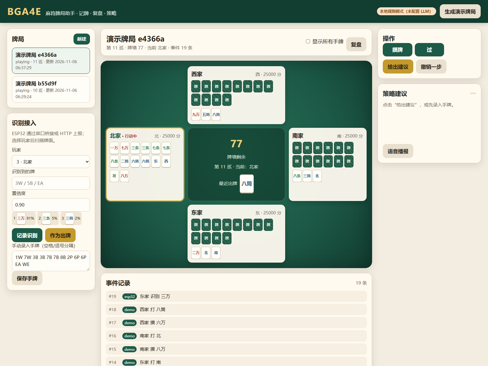

# BGA4E 鐗屽眬鍚庣涓?LLM 鍔╂墜

闈㈠悜楹诲皢鐨勨€滅墝灞€璁板綍 / 瀹炴椂灞曠ず / 澶嶇洏 / 绛栫暐寤鸿鈥濆悗绔紝鎺?ESP32-S3 鐨勮瘑鍒粨鏋滐紝骞跺彲閫夋帴鍏ヤ换鎰?OpenAI 鍏煎澶фā鍨嬨€?
瀵瑰簲寮€棰樻姤鍛婁腑鐨勶細

- **绠楁硶涓庡伐绋嬬 2 椤?*锛氳褰曟父鎴忕姸鎬佺殑鍚庣銆佺姸鎬佸睍绀恒€佸鐩橈紝骞朵笌鍥惧儚璇嗗埆妯″潡杩炴帴锛?- **绠楁硶涓庡伐绋嬬 4 椤?*锛氭帴鍏?LLM锛屾彁渚涙墦鐗岀瓥鐣ュ缓璁€?


## 1. 宸插疄鐜扮殑鍔熻兘

| 妯″潡 | 璇存槑 |
| --- | --- |
| 鐗屽眬鐘舵€?| 4 浜洪夯灏嗭細鎵嬬墝銆佸壇闇层€佸純鐗屻€佺墝澧欍€佸綋鍓嶇帺瀹躲€佸簞瀹躲€佸垎鏁般€佽儨璐?|
| 浜嬩欢婧簮 | 鎽哥墝/鍑虹墝/纰?鍚?鏉?鑳?杩?璁板垎/鎵弿/褰曞叆鎵嬬墝锛屽叏閮ㄨ惤搴擄紝鍙挙閿€銆佸彲閲嶆斁 |
| 瀹炴椂灞曠ず | 娴忚鍣ㄧ墝妗屻€佺帺瀹舵墜鐗?鍓湶/寮冪墝娌炽€佺墝澧欍€佹渶杩戝嚭鐗屻€佷簨浠舵祦 |
| 澶嶇洏 | 鎸変簨浠堕€愭鍥炴斁锛屾敮鎸佷笂涓€姝?涓嬩竴姝?鑷姩鎾斁/鎷栧姩鏃堕棿杞?|
| 璇嗗埆鎺ュ叆 | `POST /api/games/{id}/recognitions`锛涢檮 ESP32 涓插彛妗ユ帴鑴氭湰 |
| 鎵嬪姩绾犻敊 | 鎵嬪姩褰曞叆鎵嬬墝銆佹挙閿€鏈€鍚庝竴姝ワ紝閫傞厤璇嗗埆涓嶅畬缇庣殑鐪熷疄鍦烘櫙 |
| 绛栫暐寤鸿 | 鏈湴鍚戝惉/杩涘紶瑙勫垯 + LLM锛汱LM 涓嶅彲鐢ㄦ椂鑷姩闄嶇骇锛屼笉闃诲婕旂ず |
| 璇煶 | 娴忚鍣?`speechSynthesis` 鎾姤寤鸿锛岄€傞厤鑰佸勾鐢ㄦ埛 |
| 瀹炴椂鎺ㄩ€?| WebSocket `/ws/games/{id}`锛岃瘑鍒笂鎶ュ悗鎵€鏈夐〉闈㈠悓姝ュ埛鏂?|

## 2. 蹇€熷惎鍔?
```powershell
cd M08\bga4e\backend

# 宸插垱寤哄ソ鐨勮櫄鎷熺幆澧?.\.venv\Scripts\python.exe -m uvicorn app.main:app --host 0.0.0.0 --port 8000
```

鎵撳紑 <http://127.0.0.1:8000>銆傚彸涓婅鈥滅敓鎴愭紨绀虹墝灞€鈥濆彲浠ュ厛鐪嬪畬鏁存晥鏋溿€?
濡傛灉瑕佽鍚屼竴灞€鍩熺綉鍐呯殑 ESP32 鎴栨墜鏈鸿闂紝浣跨敤 `--host 0.0.0.0`锛屽苟鍦?Windows 闃茬伀澧欐斁琛?8000 绔彛銆?
### 渚濊禆瀹夎锛堟崲鏈哄櫒鏃讹級

```powershell
python -m venv .venv
.\.venv\Scripts\python.exe -m pip install -r requirements.txt
```

## 3. 涓ょ浣跨敤妯″紡

### 3.1 婕旂ず / 鎵嬪姩妯″紡

鈥滄柊寤衡€濈墝灞€鏃跺嬀閫夆€滆嚜鍔ㄥ彂鐗屸€濓紝绯荤粺浼氶殢鏈哄彂 13 寮狅紱鍙互姝ｅ父鎽哥墝銆佸嚭鐗屻€佺/鍚?鏉?鑳★紝閫傚悎婕旂ず鍜岃鍒欐祴璇曘€?
### 3.2 鐪熷疄鎽勫儚澶存ā寮?
鎽勫儚澶村彧鐪嬪埌妗岄潰涓婄殑寮冪墝锛岀湅涓嶅埌鍥涘鎵嬬墝锛屽洜姝ゆ柊寤虹墝灞€鏃讹細

- 鍙栨秷鍕鹃€夆€滆嚜鍔ㄥ彂鐗屸€濓紱
- 绯荤粺鑷姩鍏抽棴鈥滀弗鏍兼牎楠屾墜鐗?杞鈥濓紙涔熷彲浠ユ墜鍔ㄥ彇娑堬級銆?
杩欐牱姣忔璇嗗埆鍒颁竴寮犳墦鍑虹殑鐗岋紝灏辫兘璁板綍锛?
```json
POST /api/games/{game_id}/recognitions
{
  "player": 0,
  "tile": "3W",
  "confidence": 0.92,
  "top3": [{"tile": "3W", "confidence": 0.92}],
  "source": "esp32"
}
```

闇€瑕佺粰鏌愪綅鐜╁绠楀悜鍚?杩涘紶鏃讹紝鍦ㄥ乏渚р€滄墜鍔ㄥ綍鍏ユ墜鐗屸€濋噷杈撳叆 13 鎴?14 寮犵墝锛堝 `1W 2W 3W 4B 5B EA`锛夛紝鎴栬€呰皟鐢細

```http
POST /api/games/{game_id}/hands/0
{"tiles": ["1W","2W","3W","4B","5B","EA"]}
```

鍚庣画鍙互鎶婅闊宠瘑鍒埌鐨勨€滄垜鐨勬墜鐗屾槸鈥︹€︹€濇帴鍒拌繖涓帴鍙ｃ€?
## 4. 杩炴帴 ESP32 璇嗗埆妯″潡

### 4.1 鍥轰欢杈撳嚭

`firmware_app/main/APP/esp_card_recognition.cpp` 鍦ㄦ瘡甯ц瘑鍒悗杈撳嚭锛?
```text
I (12345) CARD_RESULT: {"mode":"mahjong","tile":"3W","conf":0.923}
```

閲嶆柊缂栬瘧鐑у綍鍚庯紝涓插彛灏辫兘鐪嬪埌杩欎竴琛屻€?
### 4.2 PC 涓插彛妗ユ帴

```powershell
.\.venv\Scripts\python.exe tools\serial_bridge.py `
  --port COM5 --game <缃戦〉宸︿晶鐨勭墝灞€ID> --player 0
```

鑴氭湰榛樿 1.5 绉掑唴鐩稿悓缁撴灉鍙笂鎶ヤ竴娆★紝閬垮厤涓€甯т竴鏉″埛灞忥紱`--dry-run` 鍙互鍏堜笉鍐欏悗绔紝鍙墦鍗般€?
### 4.3 鐩存帴 HTTP锛圵iFi锛?
濡傛灉鍚庣画缁?ESP32 鍔?WiFi锛屽彲浠ョ洿鎺ユ妸鍚屾牱鐨?JSON POST 鍒帮細

```text
http://<PC 灞€鍩熺綉 IP>:8000/api/games/<game_id>/recognitions
```

鍚庣宸插紑鍚?CORS锛孍SP32銆佹墜鏈恒€佸彟涓€涓綉椤甸兘鍙互涓婃姤銆?
## 5. 鎺ュ叆 LLM

澶嶅埗閰嶇疆锛?
```powershell
Copy-Item .env.example .env
notepad .env
```

濉叆浠绘剰 OpenAI 鍏煎鏈嶅姟锛?
```dotenv
LLM_API_KEY=sk-...
LLM_BASE_URL=https://api.deepseek.com/v1
LLM_MODEL=deepseek-chat
```

閲嶅惎鏈嶅姟鍚庯紝鍙充笂瑙掑窘绔犱細鍙樻垚鈥滃ぇ妯″瀷宸叉帴鍏モ€濄€傜偣鍑烩€滅粰鍑哄缓璁€濇椂锛?
1. 鏈湴瑙勫垯鍏堢畻鍚戝惉銆佽繘寮犮€佸€欓€夊嚭鐗岋紱
2. 鎶婄墝灞€鎽樿 + 瑙勫垯鍒嗘瀽浜ょ粰 LLM锛?3. LLM 杩斿洖 JSON锛歚action/tile/reason/confidence/alternatives`锛?4. 鍚庣鏍￠獙寤鸿鏄惁鍚堟硶锛屼笉鍚堟硶鎴栬秴鏃跺垯鍥為€€鍒版湰鍦拌鍒欍€?
**娌℃湁 API Key 涔熻兘瀹屾暣婕旂ず**锛氬窘绔犳樉绀衡€滄湰鍦拌鍒欐ā寮忊€濓紝寤鸿鐢卞悜鍚?杩涘紶绠楁硶缁欏嚭銆?
鐜鍙橀噺涔熸敮鎸侊細

```powershell
$env:LLM_API_KEY="sk-..."
$env:LLM_BASE_URL="https://api.deepseek.com/v1"
$env:LLM_MODEL="deepseek-chat"
```

## 6. API 涓€瑙?
| 鏂规硶 | 璺緞 | 璇存槑 |
| --- | --- | --- |
| GET | `/api/health` | 鍋ュ悍妫€鏌ャ€丩LM 鏄惁閰嶇疆 |
| GET | `/api/meta/tiles` | 鐗屼唬鐮?涓枃鍚?棰滆壊 |
| GET | `/api/games` | 鐗屽眬鍒楄〃 |
| POST | `/api/games` | 鏂板缓鐗屽眬 |
| POST | `/api/games/demo` | 鐢熸垚闅忔満婕旂ず鐗屽眬 |
| GET | `/api/games/{id}` | 褰撳墠鐘舵€?+ 鍚堟硶鎿嶄綔 |
| DELETE | `/api/games/{id}` | 鍒犻櫎 |
| GET | `/api/games/{id}/events` | 浜嬩欢鍒楄〃锛坄?after=seq`锛?|
| POST | `/api/games/{id}/events` | 杩藉姞鍔ㄤ綔浜嬩欢 |
| POST | `/api/games/{id}/recognitions` | 涓婃姤璇嗗埆缁撴灉锛坰can锛?|
| POST | `/api/games/{id}/hands/{player}` | 鎵嬪姩褰曞叆鎵嬬墝 |
| POST | `/api/games/{id}/advice` | 鑾峰彇绛栫暐寤鸿 |
| POST | `/api/games/{id}/undo` | 鎾ら攢鏈€鍚庝竴鏉′簨浠?|
| GET | `/api/games/{id}/replay` | 澶嶇洏蹇収 |
| GET | `/api/games/{id}/hand/{player}` | 鍗曚汉鎵嬬墝鍒嗘瀽 |
| GET | `/api/current/summary` | 鏈€杩戜竴灞€鐨勭簿绠€鐘舵€侊紙灏忔櫤鐢級 |
| POST | `/api/current/advice` | 鏈€杩戜竴灞€鐨勭瓥鐣ュ缓璁?|
| POST | `/api/current/hands/{player}` | 鏈€杩戜竴灞€褰曞叆鎵嬬墝 |
| POST | `/api/current/events` | 鏈€杩戜竴灞€杩藉姞浜嬩欢 |
| WS | `/ws/games/{id}` | 瀹炴椂鐘舵€佹帹閫?|

浜や簰寮忔枃妗ｏ細<http://127.0.0.1:8000/docs>

浜嬩欢绫诲瀷锛?
```text
draw / discard / peng / chi / gang / win / pass / scan / set_hand / score
```

## 7. 鐩綍缁撴瀯

```text
backend/
鈹溾攢鈹€ app/
鈹?  鈹溾攢鈹€ main.py       FastAPI 璺敱銆乄ebSocket銆侀潤鎬侀〉闈?鈹?  鈹溾攢鈹€ game.py       楹诲皢鐘舵€佹満銆佷簨浠跺簲鐢ㄣ€佸悎娉曞姩浣?鈹?  鈹溾攢鈹€ shanten.py    鍚戝惉/杩涘紶/鏈€浣冲嚭鐗?鈹?  鈹溾攢鈹€ advisor.py    鏈湴瑙勫垯 + LLM + 缂撳瓨/闄嶇骇
鈹?  鈹溾攢鈹€ tiles.py      鐗岀紪鐮併€佷腑鏂囧悕銆佽В鏋?鈹?  鈹溾攢鈹€ db.py         SQLite 浜嬩欢瀛樺偍
鈹?  鈹溾攢鈹€ schemas.py    Pydantic 璇锋眰妯″瀷
鈹?  鈹斺攢鈹€ config.py     鐜鍙橀噺
鈹溾攢鈹€ static/           鏃犳瀯寤轰緷璧栫殑鍓嶇锛圚TML/CSS/JS锛?鈹溾攢鈹€ tools/
鈹?  鈹斺攢鈹€ serial_bridge.py
鈹溾攢鈹€ tests/            pytest
鈹溾攢鈹€ docs/screenshot.png
鈹溾攢鈹€ requirements.txt
鈹斺攢鈹€ .env.example
```

## 8. 娴嬭瘯

```powershell
.\.venv\Scripts\python.exe -m pytest -q
```

褰撳墠瑕嗙洊锛氱墝缂栫爜瑙ｆ瀽銆佸悜鍚?涓冨/鍗佷笁骞恒€佹渶浣冲嚭鐗屻€佸垱寤虹墝灞€銆佹懜鎵撱€佹挙閿€銆佸鐩樸€佽瘑鍒笂鎶ャ€佹墜鍔ㄥ綍鍏ユ墜鐗屻€佹紨绀虹墝灞€銆丩LM 闄嶇骇銆?
## 9. 灏忔櫤璇煶 / LLM 鎺ュ叆

濡傛灉璁惧绔娇鐢?[xiaozhi-esp32](https://github.com/78/xiaozhi-esp32) 鍋氳闊充氦浜掞紝鍙互鎶婃湰鍚庣浣滀负鈥滅墝灞€宸ュ叿鈥濇寕鍒板皬鏅虹殑 MCP 涓婏細灏忔櫤璐熻矗鍞ら啋銆丄SR銆丩LM 瀵硅瘽鍜?TTS锛屽悗绔彧璐熻矗鐗屽眬鐘舵€併€佸悜鍚?杩涘紶鍜岀瓥鐣ャ€?
### 9.1 鍚庣鎻愪緵鐨勨€滃綋鍓嶇墝灞€鈥濇帴鍙?
灏忔櫤璁惧涓嶉渶瑕佺煡閬撴瘡灞€ ID锛岀洿鎺ヨ闂細

```text
GET  /api/current/summary?player=0     # 鎴戠殑鎵嬬墝銆佸悇瀹跺純鐗屻€佺墝澧欍€佹渶杩戝嚭鐗?POST /api/current/advice               # {"player":0,"use_llm":false}
POST /api/current/hands/0              # {"tiles":["1W","2W","3W"]}
POST /api/current/events               # 璁板綍鍑虹墝绛変簨浠?```

`use_llm=false` 鏃跺彧璧板悜鍚?杩涘紶瑙勫垯锛岀敱灏忔櫤鐨?LLM 璐熻矗鎶婄粨鏋滆鎴愯嚜鐒惰瑷€锛岄伩鍏嶉噸澶嶈皟鐢ㄥぇ妯″瀷銆?
### 9.2 灏忔櫤绔?MCP 宸ュ叿

鍦?xiaozhi 宸ョ▼閲屾柊澧炰簡 `main/boards/common/mahjong_mcp.cc`锛屾敞鍐岋細

| 宸ュ叿 | 浣滅敤 |
| --- | --- |
| `self.mahjong.get_state` | 鑾峰彇褰撳墠鐗屽眬鎽樿 |
| `self.mahjong.get_advice` | 鑾峰彇鈥滄墦鍝紶/鐞嗙敱/鍚戝惉鈥?|
| `self.mahjong.set_hand` | 璇煶鎶ユ墜鐗屽悗褰曞叆 |
| `self.mahjong.record_discard` | 鎵嬪姩璁板綍鎵撳嚭鐨勭墝 |

閰嶇疆锛坄idf.py menuconfig` 鈫?`BGA4E Mahjong Assistant`锛夛細

```text
BGA4E_BACKEND_URL  = http://<PC 灞€鍩熺綉 IP>:8000
BGA4E_PLAYER       = 0..3
```

涔嬪悗瀵瑰皬鏅鸿锛?
- 鈥滅幇鍦ㄧ墝灞€鎬庝箞鏍凤紵鈥?鈫?璋冪敤 `get_state`
- 鈥滄垜璇ユ墦鍝紶锛熲€?鈫?璋冪敤 `get_advice`
- 鈥滄垜鐨勬墜鐗屾槸涓€涓囥€佷簩涓囥€佷笁涓団€︹€︹€?鈫?璋冪敤 `set_hand`
- 鈥滆涓€涓嬶紝鎴戞墦涓変竾鈥?鈫?璋冪敤 `record_discard`

灏忔櫤鐨勪簯绔?LLM 浼氱湅鍒拌繖浜涘伐鍏风殑璇存槑锛屽苟鍐冲畾浣曟椂璋冪敤锛涘伐鍏疯繑鍥炰腑鏂囨枃鏈紝TTS 鐩存帴鎾姤銆?
> 褰撳墠閫傞厤鐨勬槸 `AiXiaoZhi_Hiwonder_Sensor`锛坸iaoZhi 1.8.9锛宍main/idf_component.yml` 瑕佹眰 ESP-IDF >= 5.4.0锛夈€?.3C 灞忓箷鐗堟湰宸插湪 ESP-IDF 5.4.4 涓婂疄娴嬬紪璇戦€氳繃锛宐in 澶у皬 `0x5dcdf0`锛?M app 鍒嗗尯鍓╀綑 16%銆?
## 10. 璁捐璇存槑涓庨檺鍒?
- **浜嬩欢婧簮**锛歚events` 鏄敮涓€浜嬪疄鏉ユ簮锛宍games.state_json` 鍙槸蹇収锛涙挙閿€/澶嶇洏閮借兘浠?`initial_json + events` 閲嶅缓銆?- **瑙傚療鑰呮ā寮?*锛歚strict_hands=false`銆乣strict_turn=false` 鏃跺厑璁稿彧璁板綍妗岄潰寮冪墝锛涙墜鐗屼负绌烘椂寤鸿鎺ュ彛浼氭槑纭彁绀衡€滃厛褰曞叆鎵嬬墝鈥濓紝涓嶄細缂栭€犮€?- **褰撳墠鍙疄鐜伴夯灏嗙姸鎬佹満**銆傛墤鍏嬬姸鎬侊紙Texas Hold'em 鐨勪笅娉ㄨ疆/鍏叡鐗?搴曟睜锛夊彲浠ュ鐢ㄥ悓涓€濂椾簨浠惰〃鍜?WebSocket锛屼絾闇€瑕佸崟鐙殑 `poker.py`锛屼笉鍦ㄦ湰娆¤寖鍥村唴銆?- **鏃犻壌鏉?*锛氳繖鏄湰鍦版紨绀?璇剧▼椤圭洰锛岄粯璁ゅ彧鐩戝惉鏈満鎴栧眬鍩熺綉銆傚叕缃戦儴缃插墠闇€瑕佸姞鐧诲綍銆侀檺娴佸拰 HTTPS銆?- **LLM 闅愮**锛氱墝灞€鎽樿浼氬彂閫佸埌閰嶇疆鐨勬ā鍨嬫湇鍔★紱濡傛灉娑夊強鐪熷疄鑰佷汉鏁版嵁锛屽缓璁湰鍦版ā鍨嬫垨鑴辨晱銆?- **璇嗗埆鎺ュ叆**锛氬綋鍓嶇敤 PC 涓插彛妗ユ帴锛岄€傚悎鏈儳褰?璋冭瘯闃舵锛涗骇鍝佸寲鏃跺缓璁?ESP32 鐩存帴 WiFi HTTP 鎴?MQTT锛屽苟鍔犳柇绾块噸杩炰笌鏈湴缂撳瓨銆?
