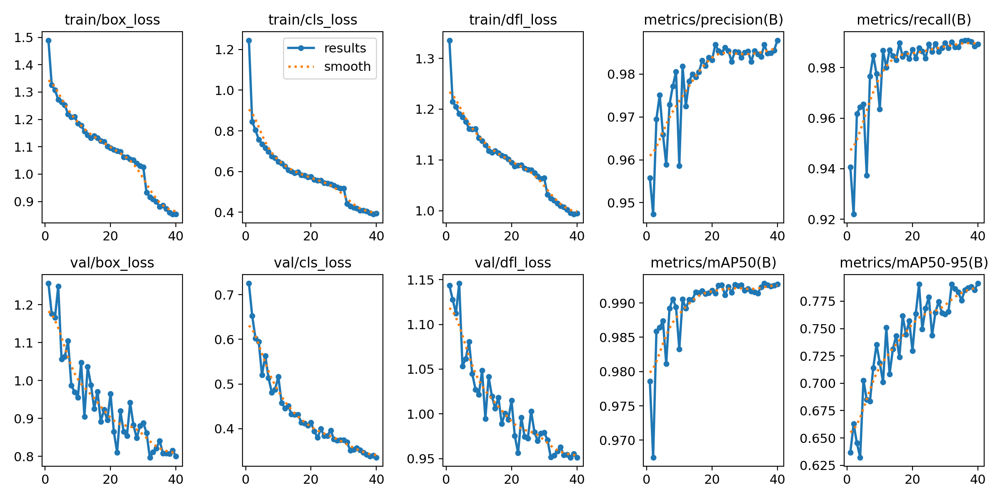

# 麻将 / 扑克牌识别 —— 训练报告

> 生成时间：2026-10-30
> 代码与权重：`M08/bga4e`

---

## 1. 实验目标

在 PC 上训练一套可迁移到 ESP32-S3 的牌类识别模型：

1. **检测**：在 640×640 画面中定位麻将牌 / 扑克牌；
2. **分类**：把检测框裁剪后识别成具体牌名（麻将 42 类、扑克 52 类）；
3. **可部署**：分类器只使用 ESP-DL 支持的算子，可量化到 int8。

---

## 2. 数据与标注修复

### 2.1 原始数据

| 数据集 | 图片 | 原始框 | 类别 |
| --- | ---: | ---: | ---: |
| 扑克 `poker_yolo_real` | 1,285 | 5,574 | 53（含脏类） |
| 麻将 `mahjong_yolo_real` | 3,713 | 53,687 | 42（无类别名） |

### 2.2 修复内容

| 问题 | 处理 | 影响 |
| --- | --- | --- |
| 麻将无 `data.yaml` / 类别名 | 逐类采样 4–8 张裁剪图人工核对，写入 `class_maps.json` | 42 类可训练 |
| 扑克类别索引错位 | 按「代表图 + COCO 交叉验证」重映射，0–18 与 20 全部修正 | 牌名不再整体错位 |
| 扑克脏类 `59` | 合并进 `10♦` | 回收 104 个有效框 |
| 扑克 1 个 J♦ 噪声框 | 删除源类别 19 | 去掉 1 个错标 |
| 麻将整排/粘连大框 | 删除面积 > 5% 的框（4,032 个） | 检测目标变干净 |
| 麻将长宽比异常 | 删除 1,926 个 | 减少漏标/横条 |
| 重复/极小框 | 删除 37 + 12 个 | — |

清洗后：

| 划分 | 麻将图片 / 框 | 扑克图片 / 框 |
| --- | ---: | ---: |
| train | 2,752 / 40,921 | 964 / 4,162 |
| valid | 311 / 4,409 | 193 / 836 |
| test | 167 / 2,350 | 128 / 553 |

> 麻将 train 有 398 张图因「所有框都是整排大框」被清空；这些图会在 `14_autolabel.py` 中用模型重新补框。

### 2.2.1 模型辅助补标注结果

| 项 | 麻将 | 扑克 |
| --- | ---: | ---: |
| 恢复的图片（train+valid） | 457 | 0 |
| GT 匹配率 | 98.5%（44,638/45,330） | 99.6%（4,978/4,998） |
| 新增框 | 823 | 2 |

补标后用 `datasets/det_auto`（训练集 4,114 张）对检测器做了 12 epoch 微调，结果见 3.3 节。

### 2.3 分类裁剪

| 划分 | 麻将 | 扑克 | 合计 |
| --- | ---: | ---: | ---: |
| train | 41,011 | 4,072 | 45,083 |
| valid | 4,428 | 817 | 5,245 |
| test | 2,350 | 553 | 2,903 |

裁剪规则：检测框外扩 10% → 补成正方形（灰底 114）→ 112×112 JPEG；训练时随机裁剪到 96×96。

---

## 3. 检测器

- 模型：YOLOv8n（COCO 预训练）
- 输入：640×640，batch 16
- 类别：0 = 麻将牌，1 = 扑克牌
- 训练：40 epoch，RAM cache，8 dataloader workers
- 增强：mosaic、mixup 0.05、HSV、±8°、translate 0.1、scale 0.55、perspective

### 3.1 训练曲线

### 3.2 测试集指标

| 指标 | 值 |
| --- | ---: |
| Precision | 0.9934 |
| Recall | 0.9756 |
| mAP50 | **0.9866** |
| mAP50-95 | **0.7931** |

分类别：

| 类别 | mAP50 | mAP50-95 |
| --- | ---: | ---: |
| 麻将牌 | 0.9782 | 0.7562 |
| 扑克牌 | 0.9950 | 0.8300 |

混淆矩阵（归一化）：`report/det/confusion_matrix_normalized.png`。

### 3.3 补标注后的微调对比

用 `datasets/det_auto`（补标后 4,114 张训练图）从 v1 微调 12 epoch，在**同一个 test split** 上对比：

| 版本 | Precision | Recall | mAP50 | mAP50-95 |
| --- | ---: | ---: | ---: | ---: |
| v1（清洗 GT） | **0.9934** | **0.9756** | 0.9866 | 0.7931 |
| v2（+ 自动补标微调） | 0.9870 | 0.9732 | 0.9865 | **0.7935** |

两者基本持平；v1 的 precision/recall 更好，因此最终部署仍用 **v1**，v2 存档在 `models/detector/auto/`。补标数据 `datasets/det_auto` 仍保留，后续可继续扩充。

---

## 4. 分类器

- 结构：深度可分离 CNN（`scripts/cardnet.py`）
- 输入：96×96 RGB
- 参数量：约 0.31 M
- 损失：CE + label smoothing 0.1
- 采样：1/√类别频次
- 增强：旋转、随机裁剪、透视、颜色抖动、随机擦除
- 训练：麻将计划 35 epoch（best 出现在 epoch 11；训练进程在约 30 epoch 时因 Windows DataLoader 资源问题停止，用 best.pt 完成评估/导出），扑克 45 epoch

### 4.1 麻将 42 类

| 指标 | 值 |
| --- | ---: |
| best val top-1 | 0.9689 |
| test top-1 | **0.9753** |
| test top-3 | **0.9962** |
| test 样本数 | 2,350 |

混淆矩阵：`models/classifier_mahjong/confusion_test.png`。最弱的是花牌（每类测试样本仅 10–18 张），例如 梅/兰/菊/竹 的 recall 在 0.80–0.94。

### 4.2 扑克 52 类

| 指标 | 值 |
| --- | ---: |
| best val top-1 | 0.8002 |
| test top-1 | **0.7866** |
| test top-3 | **0.9638** |
| test 样本数 | 553 |
| int8 top-1 | 0.7794 |
| int8 大小 | 366.0 KB |

> 扑克原始标注存在少量「框画到相邻牌上」的噪声，因此 test top-1 会低于麻将；混淆矩阵见 `models/classifier_poker/confusion_test.png`。

端到端评估中最主要的混淆是**红桃 / 方块**（`A♥↔A♦` 各 5 次、`6♥→6♦` 4 次、`5♦→5♥` 4 次），其次是 J/Q/K 的点数混淆。96×96 输入下红色花色的形状差异被压缩得比较厉害；下一步可把输入提高到 128×128，或先裁角标再做花色分类。

---

## 5. 端到端（检测 + 分类）

测试集：麻将 167 张 / 扑克 128 张。评估方式：检测框与 GT IoU ≥ 0.5 视为检出，再比较分类结果。

| 指标 | 麻将 | 扑克 | 合计 |
| --- | ---: | ---: | ---: |
| GT 框数 | 2,350 | 553 | 2,903 |
| 检出率 | 0.9596 | 0.9964 | 0.9666 |
| 检出框分类正确率 | 0.9818 | 0.7913 | — |
| 端到端正确率 | **0.9421** | **0.7884** | **0.9128** |

可视化：`report/pipeline_*.jpg`（红框 GT，绿框预测）。

---

## 6. 量化（ONNX int8，per-channel）

| 模型 | FP32 top-1 | int8 top-1 | FP32 大小 | int8 大小 |
| --- | ---: | ---: | ---: | ---: |
| 麻将 42 类 | 0.9753 | **0.9745** | 1282.2 KB | **360.9 KB** |
| 扑克 52 类 | 0.7866 | **0.7794** | 1302.3 KB | **366.0 KB** |

量化后精度损失 < 1%，模型体积约为 FP32 的 28%。

### 6.1 ESP-DL 端侧系数（已实际导出）

用 `02_Face_recognition_project/components/esp-dl/tools/quantization_tool` 的官方 Calibrator（Python 3.7，int8 per-channel entropy，esp32s3）导出：

| 模型 | 系数文件 | 大小 | 输入指数 | 输出指数 |
| --- | --- | ---: | ---: | ---: |
| 麻将 42 类 | `firmware/mahjong/espdl_coeff/card_cls.cpp/.hpp` | 2.65 MB 源码 | -7 | -4 |
| 扑克 52 类 | `firmware/poker/espdl_coeff/card_cls.cpp/.hpp` | 2.69 MB 源码 | -7 | -4 |

逐层指数见 `firmware/*/card_classifier_model.hpp` 的构造参数（例如麻将 stem=-5、features.4.dw=-3、head=-5）。C++ 模型按 ESP-DL 1.x 的 `Conv2D` / `DepthwiseConv2D` / `GlobalAveragePool2D` / `FullyConnected` 编写，尚未在真实板子上编译验证。

---

## 7. 结论

1. 数据清洗与类别重映射是本次提升最大的环节：麻将补齐了 42 类语义，扑克修正了整体错位，检测 mAP50 达到 **0.9866**。
2. 2 类检测 + 单牌分类的两级方案在测试集上端到端 **0.9128**（麻将 0.9421 / 扑克 0.7884），满足课程 demo 需求。
3. 分类器结构简单（~0.31 M 参数），int8 后约 0.3 MB，适合 ESP32-S3；检测器端侧部署建议改用颜色/形状定位，或进一步量化 YOLO。
4. 主要剩余误差：扑克标注噪声、麻将花牌样本少、真实场景遮挡/反光。
